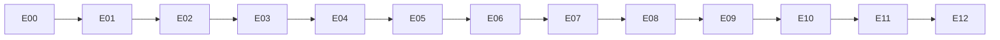

# G.O.D.S.E.Y.E V1 development plan

Status: E01–E06 local implementation assessed; E07 local Agent Center, advanced chat, trusted data tools, locally qualified coding runners and requested bounded owner-approved orchestration implemented, 2026-11-14. The requested local orchestration software is complete and locally verified. See the story-level local completion/qualification table below; complete deployed E07 and V1 acceptance remain distinct. Historical checkpoints apply to their original source. Scope authority: [V1 requirements](../spec/v1.md), [isolation/data contract](../spec/isolation.md), [ADR-002](../adr/ADR-002-professional-vm-and-dual-stack.md) and [ADR-003](../adr/ADR-003-local-first-and-ci.md).

Server update 2026-11-16: the platform runs on the dedicated server (a Hetzner `EX44-1-LTD`, not the AX41 first assumed); owner API is `1.22.0`; delivery uses Docker + `runsc` without Coolify, the control DB is PostgreSQL 17 and project cells PostgreSQL 18, the console is reachable only over WireGuard ([ADR-021](../adr/ADR-021-direct-docker-runsc-delivery-and-server-decisions.md)); custom domains are F47 ([ADR-020](../adr/ADR-020-custom-application-domains.md)); the work VM sandbox is the server-only deviation I10a. Server qualification status lives in the [execution ledger](../operations/dedicated-server-execution.md). Story rows below that say Coolify or AX41 are corrected inline; the historical checkpoint text keeps its original wording.

## Delivery rules

Each story produces a reviewable artifact, executes its named tests when the implementation exists, records evidence and leaves a rollback/checkpoint. Epics integrate into the same eventual product; a completed private checkpoint is not a public release. Requirements F01-F47, I01-I16 (including the server-only deviation I10a), D01-D10 and N01-N08 remain mandatory regardless of implementation order.

Effort labels are relative planning signals: S is a bounded component/flow, M crosses several modules, L is a provider or major data/runtime boundary. They are not hour/day estimates. There is no comparable project delivery record or qualified infrastructure yet; calendar commitments require E00 results. Dependencies are stated in the table below; story order within an epic is sequential unless independence is explicitly established. No parallel implementation ownership is assigned in this document.

## Dependency graph

The baseline sequence is deliberately conservative for a solo operator. Console views, authorization, audit and telemetry are built with each owning epic; the UI is not postponed until E10. E10 completes local decision routing and cross-feature experience. Future parallelization requires stable contracts and non-overlapping file ownership.

| Epic | Outcome | Direct prerequisite | Required feature ownership | Effort/risk |
| --- | --- | --- | --- | --- |
| E00 | Prove the uncertain isolation/runtime topology and capacity | None | Qualification of I01-I16/D01-D10 | L / high |
| E01 | Repository, contracts, operation engine and verification harness | Local subset may precede E00; remote capabilities still require E00 | F35, F39, F44 foundations | L / high |
| E02 | Private owner console, credentials and infrastructure admission | E01 | F01, F05, F06, F42 | L / high |
| E03 | Project/environment cells and independent data recovery | E02 | F03, F04, F12, F13, F15 | L / high |
| E04 | Application backend, auth, files, realtime and SDK | E03 | F16, F17, F18, F19 | L / high |
| E05 | Git/image delivery, domains, previews and rollback | E04; local event/configuration preparation may precede remote qualification | F07, F08, F09, F10, F11, F14, F44, F45, F46, F47 | L / high |
| E06 | Per-cell durable jobs, cron, outbox and recovery | E05 | F20, F21 | L / high |
| E07 | Hermes Agent Center, skills, execution grants, remote coding and run recovery | E06 | F22, F23, F24, F25, F34, F43 | L / high |
| E08 | Usage, budgets, operational views and incidents | E07 | F02, F30, F31, F32, F33 | L / high |
| E09 | Recurring security, log investigation and market/marketing skills | E08 | F26, F27, F28 | M / high |
| E10 | Evaluated Laya cascade and complete owner UX | E09 | F29, F40 | M / medium |
| E11 | Personal services, migration/export and retention workflows | E10 | F36, F38, F41 | M / high |
| E12 | Full disaster recovery, integration soak and V1 release | E11 | F37 plus all-feature release evidence | L / high |

## E00 Qualification before architectural commitment

The target-specific [dedicated-server specification](../spec/dedicated-server.md) and [installation plan](dedicated-server-installation.md) expand E00 into execution phases P00–P09 with acceptance DS01–DS14. They define planned evidence and do not certify a deployed server.

This is infrastructure experimentation for the final V1, not a reduced product. It must resolve the largest uncertainties first. Experiments use isolated fixtures and no real production data. Record exact versions, hardware, memory/disk/CPU and errors. Do not claim a successful source-document review proves a running boundary.

| Story | Deliverable and acceptance | Tests/evidence | Failure/checkpoint |
| --- | --- | --- | --- |
| E00.S01 | Inspect actual server (EX44, first assumed AX41) CPU/RAM/disks/SMART/addressing; design mirrored storage, private network, off-host repository and host recovery. | T03/T31 prerequisites; inventory and recovery worksheet | No reinstall before backup/ownership check; Rescue access retained |
| E00.S02 | Establish one professional VM with two gVisor cell fixtures, separate games VM and optional host-level disposable-task allocation. Prove sandbox/management/network denial, effective runtime and one-IPv4/dual-stack paths. | T02-T05; network matrix and resource traces | Remove only fixture cell resources/task guests; retain host console |
| E00.S03 | Qualify Docker `--runtime=runsc` selection by the platform adapter (Coolify dropped, ADR-021) after deploy/redeploy, manifest restrictions, dedicated PostgreSQL/Redis/Inngest and backup/PITR restore in the intended cell size. | T04/T06/T07/T11/T20/T34 | Reject engine/settings that cannot enforce profile; retain images/exports |
| E00.S04 | Qualify Hermes Runs API, explicit skills, profile ownership, disposable tool execution, cancellation and unknown-run handling. | T21-T24 | Reconcile any live run before removing fixture; revoke grants |
| E00.S05 | Measure two representative projects with prod/dev cells, games reference load and one heavy task; qualify private credential-store recovery and off-host archive connectivity. | T05/T08/T31/T36; measured compatibility/capacity report | Revise sizes/counts or require more hardware; no silent weaker isolation |

Exit: a compatibility matrix and recommended resource profiles are attached to ADR-002; every unsupported capability has a chosen resolution. Actual game/application load profiles and recovery destination are recorded. T29 Laya quality is not required yet to establish infrastructure, but its memory/CPU allocation must be bounded before E10 traffic routing.

## E01 Repository and durable control foundations

| Story | Deliverable and acceptance | Requirements/tests | Failure/checkpoint |
| --- | --- | --- | --- |
| E01.S01 | Initialize Bun workspace/package management with the qualified Node.js runtime, strict TypeScript, Biome/Husky, CI and artifact checks; no real credentials committed. | F39; T39 | Revert scaffold change; no server mutation |
| E01.S02 | Version project/action/operation contracts, scoped reference registries and final OpenAPI/SDK DTOs; define adapter capabilities. | F39/I12; T34 | Freeze v1 contracts and regenerate consistently |
| E01.S03 | Implement operation/effect journal, activation epochs, revision/idempotency, leases/fencing, approval bindings, minimum task-budget reservations and visible cleanup. Freeze action policy and grant limits before adapters can execute. | F35/I08/I12; T09/T18/T23/T24/T26 admission cases/T37 | Replay fixture journal; external intents remain visible |
| E01.S04 | Implement basic audit/telemetry context and reusable A/B integration fixtures; verify off-host audit export/gap detection. | F35/I14; T25/T37 | Retain prior audit format and stream cursor |

Current local ownership exists in `apps/control-api`, `apps/console`, `packages/contracts`, `packages/store`, `packages/core` and `tests`. The local policy, operation and audit implementations are grouped under `packages/core`; the original `packages/policy`, `packages/operations` and `packages/audit` names remain possible later boundaries, not implemented packages. Full provider/effect behavior and feature views are completed in their owning epics using this common authorization/operation layer.

## E02 Owner access, credentials and infrastructure

| Story | Deliverable and acceptance | Requirements/tests | Failure/checkpoint |
| --- | --- | --- | --- |
| E02.S01 | Build console shell, owner passkeys/private-network checks, session revocation and independent recovery procedure. | F01; T01/T33 | Revoke new enrollment; use qualified break-glass recovery |
| E02.S02 | Integrate owner-operated OpenBao credential broker, per-cell policies, static service rotation and short task grants; rehearse seal/unseal/recovery. | I08/D05; T08/T22/T31 | Fail closed for new credentials; preserve existing static service access |
| E02.S03 | Implement host VM/network inventory plus professional-VM Docker/gVisor cell provisioning, real data quotas, dual-stack ingress/egress and atomic resource reservations with policy compiler. | F05/F06/F42; T02-T05 | Reconcile allocated sandbox/network/data IDs; quarantine orphan resources |
| E02.S04 | Add infrastructure views, headroom/pressure reporting and bounded heavy-task queue. | F05/F42; T05/T25/T36 | Disable admission while retaining reads/recovery |

## E03 Project cells and databases

| Story | Deliverable and acceptance | Requirements/tests | Failure/checkpoint |
| --- | --- | --- | --- |
| E03.S01 | Build project/env lifecycle saga, server-owned resource mappings, immutable isolation profiles and suspend/resume. | F03/F04; T03/T09/T10 | Resume/compensate by recorded step; preserve live data |
| E03.S02 | Provision independent PostgreSQL instances, PGDATA/WAL and service roles; enforce HBA/TLS and defaults. | F12/F13/D01-D06; T06/T08 | Restore known role/config version; no cross-cell credentials |
| E03.S03 | Integrate pgBackRest base/archive management, recovery points and new-cell restore with paused producers, activation fencing and post-recovery-point effect reconciliation using E01 journal primitives. | F15/D07-D09; T07/T18/T30/T31 recovery-activation cases | Retain source cell; mark incomplete restore isolated and unactivated |
| E03.S04 | Add database/backup/rotation views and archive/headroom incidents. | F12/F13/F15; T06-T08/T40 | Read-only status remains usable when provider degraded |

## E04 Application backend and SDK

Local continuation authorized 2026-11-12 after the owner-requested E05 preparation slice. [ADR-010](../adr/ADR-010-independent-application-backend.md) and the [operator guide](../development/application-backend.md) define the separate cell runtime, application identity, private files, SSE and project SDK. That checkpoint used owner control API `1.6.0`; current owner API is `1.11.0` and the application API remains independently versioned at `1.0.0`. The requested local E04 tranche is complete; hosted provider, off-host recovery and all-service activation qualification remain open.

Historical E04 gates passed: 31/31 full browser journeys in 181.393319 seconds (JUnit); thirteen selected M74–M86 mutation kills in 257.091 seconds with thirteen baseline/restored passes and unchanged original source; frozen source review against 78 backend/code and twelve UI hashes; canonical builds, final affected backend rebuild, actual compiled-template HTTP/restart and SDK-consumer checks; lint (381 files), types, control OpenAPI `1.6.0` consistency and 62/62 local trace links. Final combined unit/integration verification passed 972/972 cases across 72 files in 751.83 seconds (Vitest; 752.705 seconds for the whole command). Cross-service recovery, qualified hosted providers and full E04 acceptance remain separate from this local checkpoint.

| Story | Deliverable and acceptance | Requirements/tests | Failure/checkpoint |
| --- | --- | --- | --- |
| E04.S01 | Ship Hono/Drizzle app template and per-cell Better Auth identity/origins; reject cross-project tokens and owners. | F16; T06/T14 | Retain prior app/auth schema and recovery snapshot |
| E04.S02 | Implement authorized file API, private filesystem provider, quotas, streaming/resume and recovery metadata. | F17; T16/T30 | Quarantine incomplete uploads; preserve committed objects |
| E04.S03 | Implement scoped domain-event SSE/WebSocket with cursors/refetch, bounded buffers and revocation. | F18; T17 | Fall back to refetch; do not acknowledge dropped durable events |
| E04.S04 | Ship versioned custom SDK and local-dev template; verify published contracts and no Supabase Cloud runtime path. | F19; T15/T34 | Pin last compatible SDK/API version |

## E05 Application delivery

| Story | Deliverable and acceptance | Requirements/tests | Failure/checkpoint |
| --- | --- | --- | --- |
| E05.S01 | Connect git/registry, build in disposable guest, scan/publish immutable artifact and preserve provenance. | F08; T03/T11/T39 | Revoke guest grants, retain logs, discard unpromoted artifacts |
| E05.S02 | Implement the Docker/runsc adapter (replaces the planned Coolify adapter, ADR-021) and edge/domain TLS binding to registered web services only, including verified custom domains (F47, ADR-020). | F07/F09/F47; T11/T13/T34 | Keep previous domain/artifact mapping and traffic target |
| E05.S03 | Create isolated preview cells with synthetic data and TTL cleanup; surface actual resource costs. | F10; T03/T10/T38 | Quarantine failed preview; do not touch production |
| E05.S04 | Implement migration lock, compatibility checks, readiness/smoke gates, promotion and eligible image rollback. | F09/F11/F14; T11/T12/T35 | Stop promotion; explicit data restore is separate |
| E05.S05 | Complete signed GitHub App intake, exact source bindings, transactional fanout/deduplication and current-head verification before dispatch and promotion. | F45/F46; T41/T43 | Retain received intent; stale or revoked work cannot promote |
| E05.S06 | Qualify private Jenkins (released-source job follows `main` only; `develop` is verified through the manual `godseye-platform-candidate` job before each release PR), disposable isolated agents, recurring/source-triggered pipelines, durable dispatch/result reconciliation and retained evidence. | F44; T39/T42 | Queue when runners are unavailable; reconcile unknown submissions before retry |
| E05.S07 | Implement owner-created exact-scope standing delivery policy, immutable artifact/check gates, policy revocation and stale-build fencing; preserve fresh approval for destructive/incompatible data changes and restore activation. | F46; T41/T42/T43 | Leave prior deployment serving; invalidate outdated authority and preserve failed-release evidence |

## E06 Inngest and durable application work

| Story | Deliverable and acceptance | Requirements/tests | Failure/checkpoint |
| --- | --- | --- | --- |
| E06.S01 | Provision cell-specific Inngest/Redis/workflow DB and platform engine; authenticate event ingress and worker registration. | F20/I07; T18/T20 | Freeze ingress for affected cell; retain persisted run state |
| E06.S02 | Implement local outbox dispatcher and effect keys, safe retries and uncertain-side-effect reconciliation. | F21; T18/T19 | Resume cursor/intents; never replay an unknown effect blindly |
| E06.S03 | Build cron/function catalog and job progress/pause/cancel/retry UI, restart/resume and history retention. | F20/F21; T18/T20/T24 | Pause scheduling, reconcile live jobs, preserve history |

The current local continuation decomposes E06.S01–S03 without reducing their release scope:

| Local slice | Implemented boundary and checkpoint | Remaining complete-story work |
| --- | --- | --- |
| Application bridge | Application-database job intent commits with trusted publication or a custom POST business transaction; a separate bounded dispatcher retains identity through lost acknowledgements, pruning and restart | Qualified runtime supervision, cross-service recovery and retention/reconciliation policy for all producers |
| Inngest coordination | Signed per-cell admission/result observation; the completion slice adds an independent PostgreSQL-journal supervisor, trusted cell subprocesses, actual external PostgreSQL/Redis service provisioning and separate platform engine | Deployed process/network/quota/capacity qualification and coordinated recovery |
| Exclusive calendar | Inngest-backed cells are excluded from fixture cron creation; detached runtime reconciles current signed registrations under pause/HOLD/epoch/definition authority | Actual live-cron and final regression gates passed; deployed monitoring/recovery qualification remains |

Acceptance is bound to the [E06 continuation criteria](../spec/v1.md#application-events-and-per-cell-engine-continuation).
The [operator guide](../development/application-jobs.md) distinguishes transport acceptance from
Foundation completion and native embedded persistence from external-service qualification. The
browser may disconnect while operator-composed processes continue. New native tests target owner-HTTP-independent execution and explicit trusted cell children; they do not qualify hostile code isolation. Final frozen-source, native, regression, mutation and build/smoke gates passed.

### Autonomous-worker and persistence completion slice

This continuation implements the remaining local runtime boundaries. Its acceptance criteria
are [E06-W/C/P](../spec/v1.md#autonomous-workers-and-external-persistence-continuation);
the requested local software slice is complete. Scoped native execution/persistence, full regression,
selected mutations, independent frozen source review and canonical build/smoke passed. Deployed
whole-epic acceptance and V1/host qualification remain separate.

| Local task | Deliverable | Required proof |
| --- | --- | --- |
| Detached consumer | Independent trusted supervisor on the PostgreSQL control journal; owner HTTP excludes jobs, supervisor excludes unrelated adapters | `T-E06-W02`, `T-E06-W04`; real independent connections/processes |
| Application workers | One first-party child per cell, explicit environment, scoped bounded IPC and parent-held Foundation callbacks | `T-E06-W01`, `T-E06-W03`, `T-E06-W05`, `T-E06-W06`; no owner/foreign authority in child |
| Live catalog | Signed SDK registration reconciles current cron definitions without process restart; one calendar and current hash/lifecycle authority | `T-E06-C01`; actual registration and stale-catalog negative probes |
| External persistence/platform | Authenticated workflow PostgreSQL/Redis per application engine plus independent platform engine; no embedded fallback | `T-E06-P01`–`T-E06-P04`; actual waiting-workflow/service restart and cross-cell refusal |

Native process tests do not qualify hostile-code containment, Docker/gVisor limits, private deployed
networking, off-host custody or coordinated E03/E12 restore activation. Those remain release gates.
Existing owner/project/backend configuration and definitions must be created explicitly; this slice
does not enroll an owner, provision the dedicated host or authorize Git publication.

The requested E06 local software completion passed the fresh **1,225-case default suite** in
**950.24 seconds Vitest wall time**, all eleven native opt-ins separately, eight Python helper
regressions, seven selected mutation kills, independent frozen source review, 527-file lint/types/
contracts, dependency audit and canonical build/built smoke. Native store/process tests demonstrate
actual local autonomy and durability; they do not certify deployed isolation or coordinated recovery.
See [final aggregate gates](../../tests/STRATEGY.md#final-aggregate-gates-for-local-e06-completion).
No current local E06 task in this slice remains pending; E00 and cross-epic release gates remain.
## E07 Hermes core operations

Historical setup checkpoint, 2026-11-13: the initial request covered installation,
profile preparation and skill versioning only. [ADR-013](../adr/ADR-013-local-hermes-setup.md)
and the [local guide](../development/hermes.md) define the boundary. Hermes 0.23.1 is
pinned to its release commit with CPython 3.14.9 and a minimal frozen PM environment.
Operations, security and research-marketing templates prefer the OpenAI API; no key
or model call is used during setup. One bootstrap context skill is versioned with
provenance and exact file digests. Profiles have separate native homes, immutable
snapshots, exact promotion/rollback and concurrent-writer exclusion. They report
declared-local scope and no run authority. This is a **partial E07.S01** checkpoint;
owner/Agent Center binding and explicit skill preloading in a qualified run remain
pending. S02–S05 and all E09 operational bundles remain pending. No server setup is
included. Earlier epic evidence remains historical for its frozen source.

Historical Agent Center continuation, 2026-11-13: [ADR-014](../adr/ADR-014-owner-bound-agent-center.md)
and the [operator guide](../development/agent-center.md) supersede the setup-only execution
boundary. S01 now includes real owner project/environment binding, profile revisions,
pause/resume and one exact trusted skill. S02 adds durable Runs correlation, task history
and bounded polling; interactive chat/SSE, artifacts and clarification remain open.
S03 adds shared Foundation budget/heavy admission, one request/turn, private model
injection, no tools, protective stop and uncertainty/reconciliation. This does not complete
general disposable tool execution or all of S03. S04/S05 and E09 remain pending.
Actual pinned Runs qualification passes text completion, hostile tool-reply refusal and
controlled hanging-request stop/settlement without replay. Full regression/build gates
are recorded separately in the test strategy; there is no
paid OpenAI call or dedicated-server qualification in this implementation tranche.

Advanced chat continuation, 2026-11-13: [ADR-015](../adr/ADR-015-durable-hermes-chat-and-exact-plan-inbox.md)
and the [chat guide](../development/hermes-chat.md) add local S02 multi-turn conversations,
actual incremental SSE, durable cursor/reopen, immutable text drafts and S04 existing-plan
owner inbox. Each response remains one separately admitted Foundation task. Actual native
text/context, truncated stream and tool refusal are measured; browser contract fixtures
are identified separately. Approvals atomically use real Foundation owner authority and
can resume already-waiting operations, with no new enqueue or broad native grant.
Native canonical paused clarification/approval tools, agent-created plans, general
disposable tools, S05 coding runners and E09 bundles remain pending. Final aggregate
verification is recorded in the test strategy; dedicated-host work remains deferred.

| Story | Deliverable and acceptance | Requirements/tests | Failure/checkpoint |
| --- | --- | --- | --- |
| E07.S01 | Build project/env/role profile lifecycle, trusted versioned skill registry and explicit preloading compatibility. | F23; T21/T22 | Restore trusted skill snapshot; avoid concurrent home writers |
| E07.S02 | Integrate Runs API, durable run correlation, SSE/chat, approval/clarification and artifacts. | F22/F25; T21/T23/T33 | Preserve provider run ID; show unknown/reconciling status |
| E07.S03 | Enforce task grants, minimum model admission against E01 reservations, disposable execution, cancellation/fencing and tool allowlists. Complete usage reporting/pricing reconciliation in E08. | F24/I10-I11; T22/T24/T26 admission/overshoot cases | Revoke grants before cleanup; quarantine failed cleanup |
| E07.S04 | Deliver approval inbox bound to immutable proposals and owner authority; agents cannot approve themselves. | F34; T22/T37 | Expire stale proposals; retain audit evidence |
| E07.S05 | Integrate at least one qualified Codex/Claude Code runner for repository/worktree tasks, typed results and preview evidence; keep its vendor auth/usage limitations explicit. | F43; T11/T21/T22/T24/T33 | Retain patch/worktree artifacts, revoke task grants, reconcile before repeating side effects |

## E08 Costs, observability and incidents

| Story | Deliverable and acceptance | Requirements/tests | Failure/checkpoint |
| --- | --- | --- | --- |
| E08.S01 | Collect scoped logs/metrics, desired/observed freshness and correlated project timelines; complete Overview. | F02/F32; T25/T33 | Mark stale; never show missing observations as healthy |
| E08.S02 | Extend E01 reservations with usage attempt ledger, price versions, unknown usage, tool/local charges, reporting and provider reconciliation; run full T26. | F30/F31; T24/T26 complete family | Stop new budgeted work on failed admission/accounting; preserve raw evidence |
| E08.S03 | Implement deduplicated incidents, owner notifications, acknowledgements/mutes and delivery-failure state. | F33; T40 | External observer detects host loss; failed delivery remains visible |

## E09 Operational skill bundles

| Story | Deliverable and acceptance | Requirements/tests | Failure/checkpoint |
| --- | --- | --- | --- |
| E09.S01 | Create recurring security skill pipelines with scoped targets, scanner evidence, previous-baseline diff and remediation artifacts. | F26; T22/T27 | Cancel active grant; retain findings/baseline; no automatic duplicate destructive scan |
| E09.S02 | Add log/metric investigation skills with redaction and deployment correlation. | F27; T22/T25/T27 | Return incomplete diagnosis when source unavailable |
| E09.S03 | Add source-linked competitor/market deltas, brand-context drafts and campaign analysis; qualify any external publishing connector separately. | F28; T28 | Preserve drafts; unknown publish outcome requires reconciliation |

## E10 Laya and owner experience

| Story | Deliverable and acceptance | Requirements/tests | Failure/checkpoint |
| --- | --- | --- | --- |
| E10.S01 | Freeze the numeric V1 evaluation policy, dataset splits, labels and resource envelope before inspecting held-out outcomes; deploy bounded local decision service and version its model/configuration. | F29; T05/T29 protocol/resource cases | No auto-triage before frozen policy and qualified artifact |
| E10.S02 | Evaluate held-out FR/EN data against the frozen macro-F1/precision/critical-override/resource targets; qualify at least one use case and then integrate the cascade with sampled review. Unqualified use cases stay disabled. | F29; T26/T29 complete family | Failed targets keep F29 incomplete; new tuning needs fresh held-out acceptance data |
| E10.S03 | Complete all owner navigation, accessibility, desktop/mobile critical flows and loading/error/stale behavior. | F40; T33 | Preserve functional routes; no decorative-only operations |

## E11 Personal services, portability and retention

| Story | Deliverable and acceptance | Requirements/tests | Failure/checkpoint |
| --- | --- | --- | --- |
| E11.S01 | Add games/bots inventory and authorized lifecycle/log adapter; keep personal networking/credentials separate. | F36; T02/T32 | Preserve game data; expose native recovery route |
| E11.S02 | Implement project export/import and case-by-case Supabase migration checks with reversible cutover. | F38; T15/T35/T38 | Keep source service until validated cutover; record dual-write limits |
| E11.S03 | Implement retention, staged deletion, quarantine/purge and protected recovery/audit history. | F41/D10; T24/T30/T38 | Stop purge on failed prerequisite; report residual resources |

## E12 Release qualification and recovery

| Story | Deliverable and acceptance | Requirements/tests | Failure/checkpoint |
| --- | --- | --- | --- |
| E12.S01 | Produce platform/owner/credential-store/file/database recovery set and runbook; restore onto clean replacement capacity. | F37; T07/T08/T30/T31 | Keep recovery source read-only and original cell intact |
| E12.S02 | Run all T01-T43, 72-hour qualified-load soak, negative isolation suite, provider outage and upgrade/rollback exercises. | All F/I/D; T01-T43 | Freeze release; classify failure and rerun affected scenarios |
| E12.S03 | Produce a release evidence ledger, pinned compatibility matrix, residual-risk/capacity report, deployment/recovery instructions and owner walkthrough. | All F/I/D; T31/T33/T34/T36/T39 | Retain last qualified release and restore point |

## Isolation implementation ownership

Qualification E00 and final E12 verification do not replace these implementation owners. Each owner records the named control's evidence with its associated tests. Scenario families may be split into cases: for example E01/E07 gate reservation/admission portions of T26, while E08 gates its complete reporting/reconciliation behavior. No family is marked fully passed before all its cases exist and pass.

| Control | Primary implementation owner | Verification |
| --- | --- | --- |
| I01 | E02.S03 and E03.S01 | T03/T09 |
| I02 | E02.S03 | T02/T03 |
| I03 | E02.S03 and E05.S02 | T02/T13 |
| I04 | E02.S01 | T01/T02 |
| I05 | E02.S03 and E05.S01 | T04 |
| I06 | E02.S03-S04 | T05/T36 |
| I07 | E03.S02 and E06.S01 | T06/T20 |
| I08 | E01.S03 and E02.S02 | T06/T08/T22 |
| I09 | E04.S01-S03 and E06.S01 | T14/T16/T17/T20 |
| I10 | E02.S03 and E07.S03 | T03/T22/T24 |
| I10a (server-only owner-accepted deviation: per-task gVisor/container sandbox inside the work VM `godseye-work`; the runner stays `available:false` until qualified) | E07.S03 | T03/T22/T24 |
| I11 | E07.S01-S03 | T21/T22 |
| I12 | E01.S02-S03 and E02.S03 | T04/T34 |
| I13 | E02.S01-S03 and E12.S01 | T01/T03/T31 |
| I14 | E01.S04 and E08.S01 | T25/T26/T38 |
| I15 | E02.S03 and E07.S03 | T02/T22 |
| I16 | E03.S03 and E12.S01 | T07/T30/T31 |

Network N01-N08 implementation belongs to E00.S02 (qualification), E02.S03 (routing/firewall/allocation), E05.S02 (DNS/TLS/ingress) and E11.S01 (game port mapping); T02/T05/T13/T32/T36/T40 verify the mapped behaviors.

## Required artifacts at V1 release

- Tested version/compatibility and resource-placement matrix, with actual host inventory.
- OpenAPI/SDK contracts, manifest exports, provider capabilities and policy profiles.
- Every F/I/D requirement linked to named test results and reproducible evidence.
- Negative cross-project sandbox/authorization/network/file/job/agent tests, plus disposable-task guest-root and outer VM-boundary tests.
- Project PITR/file recovery and whole-platform rebuild evidence; actual measured RPO/RTO.
- Agent skill/version registry, model evaluation, price ledger and known-unknown usage report.
- Owner/passkey/credential-store recovery and operational runbooks, off-host inventory and credential references.
- Explicit residual risks: one physical failure domain, trusted shared administrators, capacity ceiling and provider-specific qualifications.

Completion is behavioral, not a count of screenshots, files, coverage percentages or partially scaffolded pages. No security/recovery gate is deferred to manufacture a "90% complete" release.

## Local-first checkpoint and next sequence

[ADR-003](../adr/ADR-003-local-first-and-ci.md) amends the initial ordering: the local subset below may precede physical E00 qualification. The graph above still represents the dependency for enabled infrastructure; it does not prohibit local configuration, user journeys or isolated control-database tests. No capability can be enabled solely because its local page or configuration file exists.

### Current E01–E07 status

Owner control API: `1.22.0` (this checkpoint section was written at `1.11.0`). Application API: `1.0.0`. The [2026-11-12 audit and remediation record](../reviews/2026-11-12-e01-e06-audit.md) preserves the preceding hardening checkpoint; the current E06 continuation is described above. The detailed checkpoint table below preserves historical runs.

| Epic | Current local status | Next software work | Separate qualification |
| --- | --- | --- | --- |
| E01 | Foundations implemented; prepared CI now archives the actual browser diagnostics and approval renewal uses trusted atomic requeue admission | Preserve these contracts as concrete provider integrations are added | Actual CI, provider failures/concurrency and off-host audit destination |
| E02 | Owner/broker/inventory/headroom and bounded heavy queue implemented; approval renewal rechecks capacity atomically | Complete concrete enforcement/service integration without bypassing the shared queue | Private remote access, real rotations, quota/firewall helpers, Docker/gVisor/dual-stack and host capacity |
| E03 | Partial: independent DB operations, metadata lifecycle and held physical recovery | Compose all-service suspend/resume and resource release; schedule backups; coordinate recovery sets, old-producer fencing, external effects and approved activation | Actual deployed isolation, off-host archive and production RPO/RTO |
| E04 | Local auth/files/events/SDK/template slice implemented | Preserve coordinated recovery and jobs integration dependencies owned by E03/E06 | Hosted runtime, domains/cookies/material, hard quotas and off-host recovery |
| E05 | Partial: rich local delivery orchestration and trusted-process fixtures | Docker/runsc, DNS/TLS and Jenkins adapters exist (no Coolify); run live GitHub App authorization wiring on the server | Isolated guests, registry/scanner, production migrations and public previews |
| E06 | Requested local software complete and verified: detached supervisor, trusted per-cell workers, supported PostgreSQL/Redis provisioning, platform engine and live catalog | Preserve contracts while integrating deployed services and E03/E12 coordinated recovery | Deployed hostile-code/network/cell isolation, capacity and coordinated T07/T30 recovery |
| E07 | Local Agent Center, streaming chat/artifacts, exact approvals, trusted tools, locally qualified coding runners and requested bounded orchestration complete and locally verified | Native upstream paused-tool parity and general Hermes shell remain separate from platform controls and coding KVM; see story table | Paid entitlement, E08 invoice/reporting, deployed provider/host/containment/recovery, preview/connectors and E09 bundles |

The four audit corrections are locally verified: 16 new regression scenarios, the full 1,146/1,146 unit/integration suite across 93 files (1,033.11 seconds Vitest), and 41/41 browser journeys (315.46236 seconds JUnit) passed. Five selected mutations were killed with green baseline/restored checks and unchanged sources. Lint (471 files, including mutation scripts), types, generated OpenAPI `1.8.0`, canonical build, built-API smoke and independent source review passed; the audit remediation section retains exact evidence and scanner limits. Those counts are the preceding hardening checkpoint and do not automatically cover the subsequent Inngest source. The current continuation completes and verifies local E06 runtime supervision/external persistence. Automatic backup/coordinated recovery, concrete delivery transports and project-wide lifecycle orchestration retain their existing ownership. E00 remains deferred until the owner requests dedicated-server work.

The application-event/Inngest continuation is locally verified: the fresh complete run passed
**1,191 cases** (two opt-in native cases disabled), including **45 added ordinary scenarios**; the
explicit native gate passed **two cases**, and the full existing browser suite passed **41/41**.
Six selected mutations, frozen independent review, static checks, canonical build and built-API
smoke passed. The [final evidence table](../../tests/STRATEGY.md#final-frozen-local-evidence) records
counts/timings, retained initial failures, the Windows ACL/build corrections and scanner limits.
E06 remains partial for production worker/transport supervision, controller-offline execution,
external Redis/workflow PostgreSQL, isolated application code and coordinated recovery. E03/E05
remaining software work and E00 host qualification retain their existing ownership and gates.

### Historical checkpoints

| Area | Local checkpoint | Remaining acceptance before complete story/epic |
| --- | --- | --- |
| E00 | Owner reports a reset Ubuntu 26.04 host; no remote inspection or mutation | Verify hardware, recovery route, supported Proxmox installation, dual-stack networking, sandbox compatibility, data boundaries, recovery and measured capacity |
| E01.S01–S02 | Local foundations implemented: pinned workspace/verification tools, strict action/plan/reference and HTTP DTOs, generated/checked versioned control OpenAPI and internal owner client | Actual CI/artifact qualification and provider-specific contract qualification; the E04 project SDK remains separate |
| E01.S03–S04 | Durable effect intents and consumer, revisions/idempotency, exact approvals, leases/fencing/epochs, bounded grants/budget reservations, visible uncertainty/cleanup, retention and anchored audit export | Real provider/failure qualification, real PostgreSQL concurrency, protected off-host export/destination and release telemetry evidence |
| E02.S01 local journeys | Local owner implementation complete: passkey-only gate, fresh confirmation, key/session revocation, durable auth audit, protected state/process exclusion and online/offline recovery | Real owner/hardware enrollment and private remote access/recovery qualification; E02.S02–S04 credential broker/service identities/infrastructure remain separate |
| E02.S02 local continuation | Implemented local broker: exact project/environment/purpose service identity, metadata-only UI/HTTP, private offline material/proof handoff, FoundationEngine-bound short access and qualified rotation gates; separate core/API/browser groups and native OpenBao ACL/CAS/seal/restart cases passed | real upstream service transition/revocation, server private networking, deployment integration and off-host recovery remain distinct gates; no default transition adapter |
| E02.S03 local continuation | Local source reviewed and combined 325-case check/build/smoke passed: evidence-bound inventory, strict immutable preparation, atomic capacity/dual-stack reservations, exact Foundation admission and provider-step/reconciliation/protective-stop journal; thirty-one selected mutants killed, 18/18 browser journeys, 4/4 bounded laboratory checks and 26/26 local traceability criteria passed | Actual professional-host runtime, persistent quota/firewall/artifact helpers and both-family enforcement remain provider/E00 qualification gates |
| E03 local continuation | Verified project/environment metadata and bounded previews; independent PostgreSQL profiles/roles, exact Foundation database lifecycle and French owner UI/API `1.3.0`. Final static checks, 421/421 unit/integration cases, build/smoke, 21/21 browser journeys, 10/10 native checks and 47/47 selected mutation kills passed; backend/UI/final feedback reviews passed. See [ADR-007](../adr/ADR-007-independent-postgresql-cells.md), [operator guide](../development/project-databases.md) and [run history](../../tests/STRATEGY.md) | E03.S01 all-service project suspension/export/purge, deployed preview teardown, real Docker/VM quota/firewall/provider qualification, full migrations, rotation and all E03.S03 physical backup/PITR/activation acceptance remain open |
| E03.S03 held-recovery continuation | Local physical full/differential backup, archive checks and restore to a new held environment/allocation via Foundation and API `1.4.0`; source retained, private encrypted material, strict scope/chain/capacity, durable hold and blocked activation. Actual signed-tool lab passed 11/11 in 49.52 seconds and three new browser journeys passed in 54.8 seconds. Independent backend/UI reviews passed; 61 selected mutations killed, with two affected post-fix cases rechecked separately. Final local verification passed 596/596 unit/integration cases across 45 files in 408.36 seconds, 24/24 browser journeys in 140.767398 seconds (JUnit), static checks and build/smoke. See [ADR-008](../adr/ADR-008-local-postgresql-held-recovery.md) and [guide](../development/postgresql-recovery.md) | Default execution unconfigured; real producer fencing and complete business-effect journal, file/auth/config recovery, automatic scheduling, off-host durability, hard quotas and production RPO/RTO remain unqualified. This does not close E03.S03/D08 or all E03.S04 views/rotation/incident acceptance |
| E04 local continuation | Local application identities with actual email/password and configured OAuth fixture, independent store/files, resumable private uploads, authenticated download grants, scoped durable SSE, held file/auth/config recovery and separate TypeScript SDK/template. Owner API `1.6.0` and application API `1.0.0` stay separate. Final verification: 972/972 unit/integration cases across 72 files in 751.83 seconds Vitest (752.705 seconds whole command), 31/31 browser journeys in 181.393319 seconds JUnit, thirteen selected mutation kills with baseline/restored/source-hash proof, frozen source review and canonical builds. See [ADR-010](../adr/ADR-010-independent-application-backend.md) and [operator guide](../development/application-backend.md). | Actual hosted PostgreSQL/material/runtime/domain/proxy/cookie qualification; E06 job producers; off-host custody, external-effect reconciliation and all-service restore activation. Local capture intervals expose an unknown external PostgreSQL recovery-point gap; no complete T30/E03/E12 or V1 claim. |
| E06 local continuation | Local durable jobs and outbox on FoundationEngine: cell-scoped definitions, cron/event/manual triggers, bounded retries, fenced cancel, effect-keyed transactional outbox with owner reconciliation, hold gating, control API `1.7.0` and `/jobs` console. See [ADR-011](../adr/ADR-011-durable-jobs-and-outbox.md) and [operator guide](../development/application-jobs.md). 45 new jobs cases and 4 browser journeys pass within the full 77-file suite and 35/35 browser run | Real per-cell Inngest/Redis/workflow DB, authenticated event ingress and worker registration (E06.S01), event-job ingestion from the application backend, current-source review/traceability and T07/T30 recovery interplay remain open. The opt-in server pump and history/retention UI have since been implemented; five selected jobs mutations were killed on 2026-11-12 |
| E05 local continuation | Migration lane, scanner threshold and local usage (migration 0012) added after the checkpoint below: 282 delivery unit/integration cases, 5/5 delivery browser journeys and 16/16 selected delivery mutations passed on 2026-11-12. Signed push/PR intake and fanout; exact independent source protocol; bounded owner standing policy; shared Foundation build/artifact/stage/readiness/promotion/rollback and synthetic preview lifecycle; `/pipelines`, owner API `1.5.0` and current source/retained artifact separation. Focused actual managed-provider fixture passed 12 checks in 4.21 seconds. The combined run passed 851/851 unit/integration cases across 58 files in 569.99 seconds wall time and 28/28 browser journeys in 163.404282 seconds (JUnit), including four delivery journeys. Static checks (320 linted files, types and API `1.5.0` consistency), build/smoke and frozen backend/UI source reviews passed. The narrow responsive-CSS follow-up passed four delivery browser journeys in 58.082768 seconds with refreshed desktop/mobile visual checks; all thirteen selected delivery mutations were killed with green baseline/restored checks and unchanged original sources. Final build/smoke passed after the stylesheet change. See [ADR-009](../adr/ADR-009-local-application-delivery.md) and [operator guide](../development/application-delivery.md) | Default source/executor unconfigured; actual GitHub App access/token exchange, isolated Jenkins/build guests, trusted registry/scanner, Docker/runsc runtime, Docker/VM quota/firewall, DNS/TLS/public preview, production migration and remote provider qualification remain open. TTL stop/unpublish does not authorize persistent purge; full E05/V1 acceptance remains partial |

The requested E01 local foundation and E02 local owner implementation are complete; this does not close the full infrastructure-dependent stories or V1. The subsequent owner-requested migration to Bun 1.4.4 preserved the Node.js 24 runtime and passed the existing 153-case Vitest suite, fourteen browser cases, contract consistency, build and built-API smoke after a clean install. The [verification strategy](../../tests/STRATEGY.md) records the separate runs and limits. E02.S02 has the local implementation described by [ADR-005](../adr/ADR-005-bun-and-local-service-authority.md) and the [operator guide](../development/service-access.md). Its preceding combined 215-case check, build/smoke, eighteen selected mutations and eighteen local traceability criteria passed; that browser regression passed 16/16 cases in 53.8 seconds. E02.S03 now follows [ADR-006](../adr/ADR-006-local-inventory-and-cell-provisioning.md) and the [infrastructure guide](../development/infrastructure.md): the combined check passed 325/325 cases across thirty files in 244.70 seconds, build/smoke passed, thirty-one selected mutants were killed, and source review has no open confirmed findings after four independent fixes. The final browser suite passed 18/18 journeys in 73.155046 seconds (JUnit); the explicit laboratory alias passed 4/4 checks in 17.027 seconds (17.26 seconds total), following the earlier 14.65-second run. All 26 local traceability criteria passed. Qualify E00 on the dedicated server before enabling project/data/runtime and delivery providers. Local provider preparation does not activate remote effects. Jenkins and PostgreSQL Compose files can be reviewed independently; neither is a recorded live installation.

[ADR-004](../adr/ADR-004-owner-authority-and-foundations.md) records the implemented owner/control boundary without changing those qualification gates. Current source and launch commands are documented in [local development](../development/local.md), with Jenkins/GitHub activation boundaries in [CI preparation](../development/ci.md). The [verification strategy](../../tests/STRATEGY.md) records tested local slices and the mandatory missing families. E12 must run T01–T43 and produce the full F01–F46 evidence ledger.

## Local E07 task-scoped data tools — 2026-11-14

[ADR-016](../adr/ADR-016-task-scoped-hermes-data-tools.md) and the
[tools runbook](../development/hermes-tools.md) extend S01 profile policy, S02
standalone/chat artifact handling and S03 grants/isolated execution. Five fixed
trusted UTF-8 data operations use a profile ceiling plus explicit immutable task
subset. No-grant tasks preserve legacy no-tools/one-request behavior. A granted
loop has at most four model POSTs/three calls, one total cost reservation and durable
intent before each effect. Unknown work is never replayed; cleanup requires exact
unit invocation/OCI stopped evidence before releasing retained capacity.

Actual local helper/runsc and Foundation → pinned Hermes → scripted model → helper
proof is distinct from browser/provider fixtures. Smaller-limit kernel and lab tmpfs
negative controls are not production-bound exhaustion claims. Local acceptance for
T-AC-761–T-AC-774 passed the verification strategy and fresh reviews. Final disjoint
regression passed 1,426 cases with 28 default-native skips across 132 files; 66 new
ordinary cases are included. Eleven new actual-native cases, two selected legacy
native cases, three browser journeys and five selected mutation checks passed.
615-file lint/types/control API 1.12 contracts, canonical build and first-attempt
built smoke passed; 68 production hashes stayed unchanged. HTR-001 and HTD-001 were
resolved. No Semgrep/SBOM/OS or general-code KVM qualification is implied. E07 remains partial: native paused controls, new agent-created
plans, arbitrary shell/build disposable tools, I10 KVM qualification, S05 coding
runners and E09 operational bundles remain open. Dedicated-host work is deferred.

## Local E07.S05 coding runners — 2026-11-14

[ADR-017](../adr/ADR-017-local-coding-runners.md) and the
[coding guide](../development/coding-runners.md) record immutable owner
repository/commit preparations, independent source verification, actual Foundation
budget/epoch/heavy-task admission, logical task-private worktrees, separate
Codex/Claude Code API bindings and bounded patch/test-log evidence. Cancellation
retains uncertain resources; reconciliation is read-only and never repeats
submission. Owner API is `1.13.0`, migration `0021_coding.sql`.

Software support alone does not close S05's qualified-runner requirement. Both actual pinned CLI edit/test chains passed inside Windows/Ubuntu WSL KVM
against scripted models. Three actual Foundation/provider/controller/broker/KVM composition cases passed
with only upstream HTTPS replaced by a trusted fixture and zero paid requests. Preview remains explicitly
unavailable, and no paid upstream request, dedicated-server setup, Git publication
or subscription OAuth reuse occurred. Source/price/resource/runtime proof is
required for opt-in launch. Full E07, E09 and V1 acceptance remain open.

Coding launch proposes an owner-editable $0.50 Codex/$0.10 Claude reservation,
preserves manual edits and requires fresh explicit admission; project budgets
and Hermes defaults are unchanged. The physically qualified adapter is
Windows/Ubuntu WSL2 only. Retained coding records preserve frozen source/image
and patch/log evidence; the live guest-RAM worktree/home is not resumable.

## Local E07 orchestration — 2026-11-14

The requested local orchestration software is complete and locally verified. [ADR-018](../adr/ADR-018-approved-agent-orchestration.md)
and the [operator guide](../development/agent-orchestration.md) document API `1.14.0`,
automatic migration `0022`, strict bounded single-scope DAGs, immutable references,
recent-passkey exact approval, real Foundation service delegation and serialized
child dispatch. This closes the requested local model-proposal/approval/clarification
workflow; it does not assert physical completion of every
E07 requirement or V1 release acceptance.

| Story | Local completion at this checkpoint | Exact remaining acceptance / adjacent scope |
| --- | --- | --- |
| E07.S01 | Bound role/profile lifecycle, trusted versioned bootstrap skill and immutable snapshot/preloading compatibility implemented and previously verified; orchestration freezes current profile hashes | Native/deployed profile portability and dedicated-host runtime qualification; operational skill bundles belong to E09 |
| E07.S02 | Runs correlation, streaming multi-turn chat, inert artifacts, platform-owned exact approval and bounded clarification implemented; clarification now creates a newly approved remaining-effectful continuation | Native vendor paused-tool clarification/approval protocol parity is not exposed; paid/remote provider cancellation and deployed autonomous operation remain unqualified |
| E07.S03 | Foundation reservations/grants, scoped trusted data tools and isolated coding KVM, protective stop/fencing and unknown/no-replay recovery implemented; orchestration delegates through these controls | General native Hermes shell/build interface is not exposed; deployed I10/I11 containment, coordinated recovery and complete cross-provider acceptance remain open; full usage/pricing reconciliation belongs to E08 |
| E07.S04 | Exact existing-plan inbox plus strict successful-current-Hermes pending proposals, bounded new plan approval/rejection and separate continuation approval complete and locally verified | Native broad/session approval remains denied by design; deployed source/provider qualification remains separate |
| E07.S05 | Codex and Claude Code frozen-source repository tasks and patch/test evidence implemented; actual local Windows/Ubuntu WSL KVM CLI and Foundation composition previously verified | Native Linux/Proxmox and deployed runner qualification, real paid entitlement/accounting and separately authorized E05 preview/provider/connectors; no automatic deployment/publication |

The coordinator stores child intent/identity before admission, never impersonates
the owner and revalidates exact authority before effects and publication. Dependency
output transfer requires explicit `includeDependencyOutputs`, bounded quoted inert
context. Failure/unknown blocks dependents; read-only reconciliation never resubmits.
Answering preserves the completed prefix on the original and creates a new pending
remaining-effectful suffix plus inert answered-question provenance. Lifetime remains
bounded by the original preparation deadline; expiry prevents new admission, active
mutations and late logical success while allowing physical observation/cleanup.

Final gates passed: 60 new focused ordinary cases, 656 disjoint relevant regression
passes (one legacy opt-in skip), two desktop/mobile browser journeys, three selected
mutation kills, independent security/source review with zero open findings,
static/API checks and canonical build/smoke. The 716 related ordinary passes are
not a whole-repository suite. The final [test strategy](../../tests/STRATEGY.md#local-e07-orchestration--2026-11-14)
records exact durations, frozen inputs, scanner limits and preliminary mutation history. Earlier
coding/tool counts above are historical evidence and are not reused as orchestration
qualification. No paid calls, private binding changes or dedicated-server actions
are required for this local software continuation.

## Local E08 usage, observability and incidents — 2026-11-14

[ADR-019](../adr/ADR-019-local-usage-and-observability.md) and the
[operator guide](../development/usage-observability.md) define API `1.15.0` and
migrations `0023_usage.sql`/`0024_observability.sql`. All three requested local
software parts are complete and locally verified. Focused regressions, actual
provider composition, browser, selected mutation and static/release gates passed.
This does not certify deployed E08 or the complete V1 T26/T40 families.

| Story | Completed and locally verified behavior | External/current-source qualification still required |
|---|---|---|
| E08.S01 | Exact source-bound structured events/metrics, scoped retention/cursors/freshness, actual local CPU/memory/filesystem samples, real job/decision/headroom/incident Overview and project journal timelines | server/guest/container metrics and deployed provider observation were unavailable at this checkpoint (a host status file is published to the VM since 2026-11-16, ledger entry 024); producer continuity remains unknown; no general raw-log ingestion |
| E08.S02 | Acknowledged per-physical-request intents before POST, immutable outcomes/exclusive categories/vendor totals/cache TTL, frozen price revisions, separate estimates/conservative charge/invoice, atomic project/profile/runner rolling limits, scoped SQL pages/summaries and conservative retention; Hermes receipt refreshed and two actual provider compositions passed | Real vendor billing administration and invoice provenance unverified/unconfigured; paid usage not exercised; full current-source Coding/KVM qualification required after IPC/helper changes; installations retaining pre-E08 Hermes receipts must refresh them |
| E08.S03 | Existing lifecycle extended to global/project scope, exact detector-owned clearing coverage, bounded durable notification outbox with physical slot/timeout uncertainty and explicit-failure retries; private injectable observer/notifier contracts | No real messages or independent live host-loss observer; dead-host self-detection impossible; operator integration and real delivery qualification remain open |

The local request is not reduced to fixtures or UI: trusted brokers, Foundation
admission/settlement and server-owned collection/evaluation/pruning are integrated.
Measured native mechanism evidence and real adapter composition are tracked in the
[test strategy](../../tests/STRATEGY.md#local-e08-usage-observability-and-incidents--2026-11-14),
without extending historical E07 native proof to changed source closures.
Unknown reporting does not hold a proven-terminal physical slot, but is charged at
its conservative maximum. True physical uncertainty retains capacity/exposure.
Invoices never refund monotone Foundation charges. Ninety-day usage evidence pruning
preserves financial/unknown obligations; logs retain seven days and metrics thirty.
No paid call, private binding disclosure, external message, server action or Git
publication is authorized by this local implementation checkpoint.
