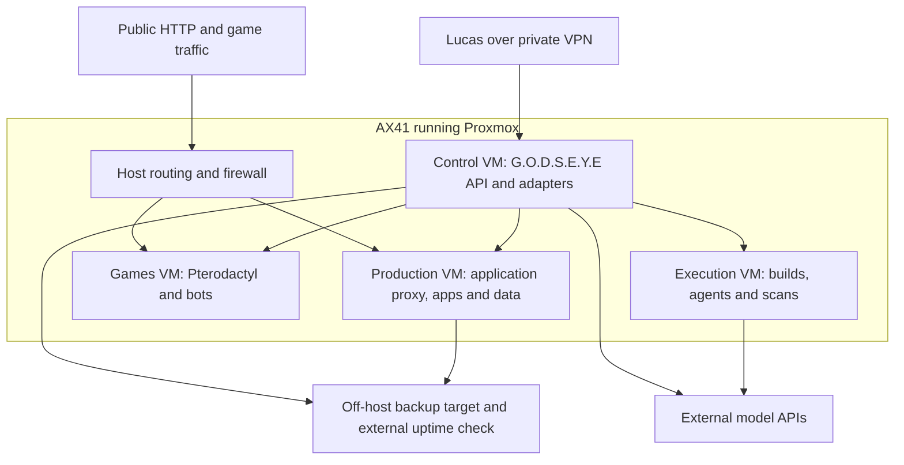

# G.O.D.S.E.Y.E architecture and delivery proposal

> Superseded by [the revised platform architecture](../architecture.md). The user clarified that n8n was a voice-transcription error, Hermes is core, and the backend should use a custom SDK. This document preserves the initial research; use the revised architecture for current product requirements.

## Verdict

Build G.O.D.S.E.Y.E as a private control platform for Lucas's projects: deployments, services, automation, agents, usage and recovery in one interface.
Use Proxmox to separate games, production, management and disposable execution; integrate existing engines through restricted server-side adapters.
Start with one complete deployment workflow. Add background orchestration and agent autonomy after resource limits, attribution and recovery work.

This is a proposal, not an installed system or an accepted implementation specification. Vendor capabilities below were checked on 2026-11-11. Resource budgets, product features and delivery gates are design recommendations, not measured capacity or vendor guarantees.

## Findings

### Hardware and capacity

Hetzner's current AX41 listing specifies Ryzen 5 3600, 64 GB DDR4, two 512 GB NVMe drives and a 1 Gbit/s connection; AMD specifies six physical cores and twelve threads. The AX name alone does not establish Lucas's installed configuration: older models and upgrades exist. Inspect Robot inventory, CPU, memory, disks and addresses before installation. [1][2][3]

For two 512 GB drives in a mirror, raw usable capacity is approximately one drive, about 477 GiB before filesystem, host and operational overhead. Mirroring protects against a drive failure; off-host backups address other failures. Actual disk sizes and health are unverified. This capacity arithmetic is conditional on the listed NVMe configuration. [1]

**Initial memory envelope, conditional on approximately 64 GiB usable RAM:**

| Zone | Initial envelope | Responsibility |
| --- | ---: | --- |
| Hypervisor, filesystem cache and free headroom | 8 GiB | Host administration and spare capacity; bound ARC if using ZFS |
| Games VM | 16 GiB | Game servers and personal Discord bots |
| Production VM | 24 GiB | Public applications, their databases and persistent volumes |
| Control VM | 8 GiB | G.O.D.S.E.Y.E, deployment controller, modest n8n/orchestration, metering and short-retention metrics |
| Execution VM | 8 GiB | One concurrent build, browser, agent or scan initially |

These are configurable upper envelopes, not expected idle usage. The control budget must be measured before enabling all optional services. Full Langfuse, multiple Supabase stacks or several game instances may require reallocating RAM or another machine. CPU allocations share six physical cores: twelve SMT threads are not twelve independent full cores. Set CPU weights and caps; throttle execution first and tune game allocations using measured latency. Add disk I/O and storage limits, not just memory limits.

The likely contention risks are simultaneous builds, game tick processing, browser sessions, database I/O and log growth. No credible number of supported projects or players can be inferred from RAM alone.

### Isolation and network

Proposed layout:

Use KVM VMs as the main trust boundaries; Docker networks remain useful within each zone. Start with a mirrored local storage pool after disk health checks. Keep management interfaces private through WireGuard or Tailscale, with host firewall rules for both IPv4 and IPv6. Hypervisor recovery through Hetzner Rescue remains independent of the dashboard.

With one public IPv4, use private VM networks, host DNAT for web traffic to the application proxy, and explicit TCP/UDP allocations to game servers. Hetzner documents NAT, routed and bridged virtualization options; additional bridged single IPs require registered virtual MAC addresses. An extra public IP is optional, not a prerequisite. [4]

Deny games-to-production access. Let execution jobs reach only their assigned preview, repository, artifact target and required external services. Do not give build or agent containers the production Docker socket, hypervisor credentials or production database credentials. The deployment adapter has broad access to its target VM, so it belongs in the management boundary.

All zones still share power, networking, CPU, disks and the physical host. This arrangement provides isolation and resource control, not high availability or protection from a whole-server outage.

### Deployment engine and the custom platform

**Recommendation: Coolify under a custom G.O.D.S.E.Y.E interface.** Its documented API triggers deployments and identifies deployment runs; current documentation also covers separate PR previews, cleanup and image rollback. Current source contains application, configuration and rollback routes. Confirm availability against a pinned release before building an adapter. [5][6][7][8]

The private platform owns the project catalog, workflows, permissions, costs, audit history, policies and unified interface. Coolify owns application deployment mechanics, proxy integration, runtime configuration and native diagnostics. Keep its native UI accessible privately for unsupported operations during early phases.

The first adapter needs: discover/create application, configure domain and environment, deploy a selected revision/image, observe deployment status, fetch logs, restart, inspect previews and request an eligible rollback. Maintain a capability matrix against the installed API. Never fill an API gap with browser automation in a critical deployment path.

Keep automatic previews restricted to trusted repository members. A build in the execution VM does not isolate the resulting preview runtime: untrusted fork code must also run in a disposable execution/preview VM, without production networking or credentials. The initial production VM preview feature is limited to trusted project code. [6]

**Alternative: Dokploy.** Official docs cover application/database provisioning and rollbacks. Preview functionality exists, but its reviewed API reference did not establish create/redeploy parity. Current license and terms also require a closer release-specific reading if this becomes a product sold to customers. This makes Coolify the simpler default for this proposal, not proof Dokploy is technically unsuitable. [9][10][11]

Coolify's reviewed v4.x core license is Apache 2.0. Dokploy's current branch separates Apache core and proprietary code, alongside terms addressing commercial service provision. Keep private internal operation distinct from white-label distribution or resale; review the exact release and agreement before a commercial expansion. This is a licensing scope flag, not a legal opinion. [8][11]

Build images in the execution zone or hosted CI and publish immutable artifacts to a registry. Production pulls the tested artifact. Run only one heavy build initially, retain a small set of successful images, expire previews and reclaim caches on a schedule. Verify the selected engine can deploy prebuilt images and expose required state through its pinned API before adopting this split.

Application rollback restores an eligible image. It does not undo database migrations or restore volumes. Prefer backward-compatible migrations and keep data recovery separate. [7]

### Data services and the Supabase ambition

Offer two project templates:

| Template | Intended use | Isolation and lifecycle |
| --- | --- | --- |
| PostgreSQL application | Default web/backend project | Per-project database and role; separate cluster/container where stronger isolation or tuning is needed |
| Supabase project | Projects needing its Auth, Storage, Realtime or generated APIs | Dedicated stack with explicit resource budget and independent backups |

Separate databases/roles on one PostgreSQL cluster reduce overhead but share cluster failure and administrator access. A dedicated cluster provides a stronger operational boundary at greater cost. Keep the platform's own metadata database separate from application data.

Self-hosted Supabase corresponds to one project per installation; managed branching, Management API and managed backups/PITR are not supplied by that installation. Its Docker guidance lists 4 GB RAM, 2 cores and 40 GB SSD minimum, with 8 GB+, 4 cores+ and 80 GB+ recommended. These are deployment guidelines, not measured idle consumption per project. [12][13]

Create a small internal provisioning API rather than promising managed Supabase parity. Its first functions are create database/role, attach to project, reference credentials securely, back up and restore to a new destination. Previews use fresh test data; production cloning requires sanitization. Object storage can be an external S3-compatible service when needed; hosting it on the same mirrored drives does not make it an off-host backup.

### n8n and Inngest ownership

Use **n8n for integrations**: schedules, incoming webhooks, enrichment, research collection, content preparation and notifications. Use **Inngest for code-defined durable jobs**: multi-step platform operations, bounded retries, waits and execution supervision. Hermes is an optional agent runtime invoked as a job, not the owner of deployment state. [14][15][16][17]

Start n8n with PostgreSQL and bounded concurrency. Introduce Redis queue mode only when measurements justify it: it adds shared database/encryption-key requirements and binary-storage constraints. Filesystem binary storage is unsupported in queue mode; paid external-storage capabilities must be checked before designing media-heavy CE workflows around them. Prefer passing object references between services. [16][18]

Keep n8n's main process in the control zone, but run Code-node JavaScript/Python through hardened **external task runners** in constrained containers in the execution zone, connected through a narrowly permitted authenticated private broker path. External task runners are distinct from queue workers. Official docs require external mode for production/sensitive instances, matching n8n/runner image versions and a runner for each execution-capable worker. Verify the cross-VM broker topology on the pinned release; do not grant runners control-plane mounts, ambient management credentials or unrestricted module access. [39]

Inngest's current self-host guide labels the single-node `inngest start` mode beta. It documents embedded Redis-compatible state plus SQLite by default, and external Redis/PostgreSQL options. Its older self-host guide also discusses production Helm deployments. These descriptions apply to different configurations; they do not establish identical maturity or cloud feature parity. [19][20]

**Default rollout:** run Inngest self-hosting in the lab first. Qualify a pinned release with durable state, process-kill/restart, retry, wait/resume and backup/restore tests before using it for critical production operations. If reliable production orchestration is needed before qualification, use managed Inngest temporarily. Do not deploy the unauthenticated development server as production. Protect management and metrics endpoints and define history retention. [19]

Give each business operation one orchestration owner. n8n may request an operation and receive completion; it must not independently retry the same publication/deployment already supervised elsewhere. Store a platform operation ID, deduplication key and correlation ID. Retries of external side effects need application-level idempotency or reconciliation: persisted workflow steps are not a universal exactly-once guarantee. [15]

n8n CE exposes a public REST API, but non-Enterprise API keys have full account access. Keep these credentials in a server-side adapter; the browser receives only platform-specific responses. CE does not include every team, SSO, environment or Git capability. Authentication to G.O.D.S.E.Y.E does not automatically enable SSO in every underlying product. [14][16][21]

Private organization use and exposing workflow configuration to external customers are different licensing scopes. n8n's licensing guidance addresses configuration through a custom UI/API/agent; Inngest's reviewed server license is SSPL with a delayed Apache grant. Revisit both before turning this internal platform into a hosted orchestration offering. [22][23]

### AI gateway and usage attribution

Route supported model API calls through **LiteLLM with PostgreSQL**, using separate service identities per project or automation. Its documented proxy supports virtual keys, spend tracking, budgets and rate limits. Budget enforcement requires a database. [24][25]

G.O.D.S.E.Y.E adds the missing attribution contract on every call:

`project_id`, `environment_id`, `workflow_id`, `execution_id`, `node_id`, `agent_run_id`, `trace_id`, provider/model, attempt, input/output/cached usage, price version, currency, latency and status.

These fields are a proposed platform contract, not metadata that every n8n integration forwards automatically. Use a shared AI sub-workflow or instrumented adapter to propagate context. Test native model nodes, HTTP nodes, agent tool calls, streaming, retries and fallbacks individually. Uninstrumented paths must appear as unattributed usage.

The initial display distinguishes **reported usage**, **estimated cost**, **unattributed usage** and **provider-reconciled totals**. Missing usage is unknown, never zero. Count provider attempts, including retries, without counting the same attempt twice. Keep cache categories and non-token charges distinct. Use bounded-cardinality metrics for dashboards and a database/trace store for per-execution detail. LiteLLM documents asynchronous spend accounting, so concurrency can overshoot a budget; combine proxy budgets with reservation estimates, concurrency limits and provider-side limits where available. [24][25]

Collect usage metadata by default. Redact credentials and personal data before persisting logs/traces; make full prompt/response capture a separate, time-limited project setting. Define deletion and retention for execution records, content artifacts and model payloads independently.

An agent authenticated through a vendor subscription may bypass this gateway. In that case, ingest its supported usage events separately; do not claim complete API-equivalent billing visibility or assume a subscription pays for arbitrary API calls. Codex's official JSONL example exposes run usage, while its automation guide recommends API keys as the default for automation. [26]

**Langfuse is optional later** for traces, prompt versions and evaluations. Its current v4 self-host architecture includes web/worker containers, PostgreSQL, Redis/Valkey, ClickHouse and object storage. Its Compose option is described for local use/testing. Defer that overhead initially; do not casually count it as a tiny production add-on. [27]

### Laya, Hermes and remote coding

**Laya:** a typed-decision model for classification/routing rather than a general text-generating assistant. CPU execution is supported upstream, but published timings on different hardware do not establish AX41 latency. The supplied laya-ai.com site explicitly identifies itself as an independent community resource; implementation decisions should use upstream code and model documentation. [28][29]

Candidate use: classify an incident or content item, route a simple task to a cheaper model and escalate uncertain cases. Adopt only after measuring accuracy, latency and resource use on representative French/English inputs. Policy and permission checks remain deterministic; model probabilities do not authorize privileged actions.

**Hermes:** an optional persistent assistant with memory, skills and messaging integrations; its documented execution backends include Docker and SSH and it accepts external model providers. Its MIT license and self-hosting fit an internal experiment. Run it in the execution boundary with specific tools and a budget; the presence of a sandbox option alone is not proof of comprehensive containment. [17]

**Remote coding is feasible:** install Codex CLI or Claude Code in an assigned server workspace. Codex supports Linux, non-interactive execution and machine-readable events. Claude Code supports programmatic execution; Remote Control keeps filesystem/tool execution on the machine running the session and uses outbound HTTPS. Thus the machine can be the dedicated server while Lucas uses a lightweight client. Model inference generally remains at the provider when using hosted models. [26][30][31][32]

For platform integration, prefer an agent runner over scraping either vendor's consumer chat UI. Each run has a repository/worktree, selected revision, credentials scoped to the task, resource limits, cancellation and retained artifacts. A coding agent proposes a change, tests it, and returns a diff or pull request plus a preview. Production promotion is a separate platform action. Start with one coding agent runtime rather than installing every candidate.

### Observability and recovery

Use Prometheus with Node Exporter for host metrics and cAdvisor for container metrics. Add application health checks and external availability checks. G.O.D.S.E.Y.E shows resource use by service and project, with drill-down into native tools. Keep metric history short initially; add centralized logs only when their operational value justifies the storage. [33][34]

Separate CPU/RAM/network/storage consumption from invoice attribution. A shared dedicated server has a fixed cost; allocating that cost by quota or usage is a chosen accounting policy. Do not present such allocations as provider-metered billing or measured electrical consumption.

Back up database-consistent exports or a qualified PostgreSQL backup system, persistent files, infrastructure configuration, workflow definitions and encrypted recovery material. Preserve n8n's encryption key securely alongside recoverable credentials. Restic supports encrypted repositories on remote storage. Keep a recovery copy outside the AX41, restrict deletion privileges where possible and test restoration into an isolated destination. [18][35]

Proposed initial recovery targets: at most 24 hours of data loss and restoration within 4 hours, to be accepted only after rehearsal. Projects needing tighter recovery require a separate WAL/PITR design, capacity and monitoring. Add an external uptime observer because an observer on the AX41 cannot report a complete host outage reliably.

### Security and marketing workflows

Security automation schedules vetted scanners and collects evidence. Run dependency/container/secret checks during delivery, and a web baseline against the resulting preview. ZAP's baseline performs crawling and passive analysis; it does not establish absence of vulnerabilities or replace a deeper assessment. Restrict any active testing to an explicit owned target/environment and run it in the execution boundary. [36]

Marketing automation collects sources, groups topics, drafts material and places proposed content in an approval inbox. Track source provenance, campaign, cost and eventual results. Use platform APIs and their actual account/permission requirements.

X's current policy prohibits unsolicited keyword-triggered automated replies and requires prior written approval for AI reply bots. Therefore the initial Twitter/X module should surface opportunities and drafts for manual posting; generic autonomous reply marketing is not an available default. Approved broadcast publishing and other channels need separate API qualification. Meta's publishing documentation could not be fetched in this research, so Instagram account/permission and publishing eligibility remain a delivery prerequisite. [37]

## Product scope

| Area | First useful behavior | Later extension |
| --- | --- | --- |
| Overview | Health, incidents, current spend and pending actions | Cross-project dependency map and capacity forecast |
| Projects | Repo, owner, domains, environment, services and database references | Reusable application blueprints |
| Deployments | Revision, logs, health, preview URL and eligible image rollback | Promotion policies and release evidence |
| Infrastructure | VM/container usage, limits, disk headroom and service lifecycle | Move a workload to another host |
| Automations | Workflow catalog, enabled state, run status, failures and links to n8n | Selected typed workflow controls; native editing stays available |
| Jobs | Inngest operation status, retries, cancellation and recovery | Cross-service execution timeline |
| Agents | Task, workspace, live events, usage, artifacts and cancellation | Special-purpose marketing/security/operations agents |
| AI costs | Project/workflow/node attribution and missing-data flags | Evaluations and provider invoice reconciliation |
| Data and recovery | Backup freshness, restore to a new destination, recovery evidence | Qualified PITR and richer storage templates |
| Approval inbox | Review a production change or prepared publication | Policy-controlled low-risk automatic actions |
| Games | Link or adapter to server status/start/stop/logs | Provisioning through a pinned Pterodactyl API |

Pterodactyl separates Application provisioning APIs and Client server-management APIs. Its current documentation distinguishes stable 1.x and 2.0 open beta; choose a version explicitly. Keep personal game/bot credentials out of the professional control path. [38]

The platform's differentiator is a shared project identity and execution timeline: a deployment, failing background job, model spend and security report are connected to the same project/environment. Merely embedding unrelated dashboards would not provide that view.

## Proposed platform implementation

Use Lucas's default TypeScript stack as the starting hypothesis: TanStack Start, Drizzle, PostgreSQL, Better Auth and Tailwind. This is not a library compatibility claim; verify current APIs and repository constraints during implementation. Start with a modular application and worker, not a microservice per dashboard tab.

Model `Project`, `Environment`, `Service`, `Deployment`, `Operation`, `WorkflowRun`, `AgentRun`, `UsageRecord`, `Approval`, `Backup` and `AuditEvent`. Store provider resource identifiers in adapters. Track desired and observed state separately; resync after downtime and expose degraded adapters without failing the entire interface.

The browser calls only the platform API. Server-side adapters enforce explicit actions and own privileged credentials. Use operation IDs, audited changes and bounded timeouts. Separate read, deploy, destructive-data and publication permissions even for a single initial user. Expose a small tool API/MCP surface to assistants only after those actions are safe and observable.

Apps and already-running jobs should continue if the dashboard frontend stops. Avoid making every application request dependent on the control API. Infrastructure manifests, image references and recovery procedures remain usable outside the UI.

## Delivery sequence and acceptance gates

1. **Foundation:** verify hardware and addressing; install Proxmox and private networks; create VMs, limits and off-host backups. Prove a full reboot preserves routing and storage, management remains private over IPv4/IPv6, games cannot access production and one backup restores.
2. **One deployment journey:** build the platform catalog and Coolify adapter; connect one repository, create a production service and an isolated preview, show health/logs, and redeploy a retained image. Check that an app keeps serving while the dashboard is unavailable. Verify database recovery separately from image rollback.
3. **Automation and costs:** add n8n, metering and an execution worker. Prove external Code-node runners cannot read unrelated control-plane files/credentials and have bounded network/resource access. Run one research/draft workflow with attributable usage; exercise streaming/retry/fallback and missing-usage cases. Demonstrate an over-budget request is stopped, then measure in-flight overshoot. Qualify Inngest restart/recovery before critical use.
4. **Remote agents:** add one Codex or Claude runner. Start a task with the PC disconnected, observe progress later, cancel it and inspect artifacts. Prove the run cannot read production credentials or exceed its configured resource envelope.
5. **Project templates and growth:** add database/restore automation, optional Supabase, security baselines and approved marketing connectors. Add more hosts when measured contention or recovery needs exceed the single-server design.

Do not estimate a delivery date before hardware inspection and adapter/API qualification. The first milestone is a tested end-to-end deployment, not a dashboard mockup with inactive controls.

## Operating costs

Use the existing AX41 invoice as the hosting baseline; its current advertised price is not Lucas's contract price. Additional recurring items are off-host backups/object storage, domain/DNS services where paid, model APIs, any paid social API access and optional managed orchestration/observability. Some features may require commercial licenses. Price these from selected accounts and measured retention before approving a monthly budget.

Use separate budgets for interactive coding, recurring research, marketing and security. No local GPU or large-model inference performance is assumed. Start with external inference; evaluate Laya as a small local experiment only if classification volume makes it worthwhile.

## Contested choices and limits

- **Proxmox versus plain Docker:** VMs add administration but match the requested perso/pro separation and isolate risky execution. Docker-only remains simpler for a trusted, homogeneous workload; it shares the host kernel. Neither solves single-host availability.
- **Coolify versus a new deployer:** integrating an engine accelerates useful behavior but creates an API/version dependency. Build a deployer only after measured API gaps justify owning its operational surface.
- **Inngest self-host versus managed:** ownership and locality favor self-hosting; current single-node beta status and recovery responsibilities favor managed service for immediately critical workflows. The qualification gate resolves the choice for the selected release.
- **n8n plus Inngest versus one orchestrator:** both are useful only with clear ownership. If an early feature needs only one, defer the second; avoid parallel retry engines for one side effect.
- **Full Supabase everywhere versus lightweight databases:** developer convenience competes with RAM/storage and preview overhead. Enable a full stack per actual application need.
- **Local versus external inference:** local classification may reduce marginal API use, but AX41 CPU contention and model quality must be measured. Marketing claims about milliseconds on other hardware are not evidence for this server.

## Sources

All sources accessed 2026-11-11. Documentation pages describe the live documented product; moving branches are implementation evidence, not a pinned production release. Entries from one vendor share an independence group. The proposal does not count multiple pages from that vendor as independent confirmation.

| ID | Source | Group |
| --- | --- | --- |
| 1 | [Hetzner AX41 specification](https://www.hetzner.com/dedicated-rootserver/ax41/?country=ro) | Hetzner |
| 2 | [AMD Ryzen 5 3600 specifications](https://www.amd.com/en/support/downloads/drivers.html/processors/ryzen/ryzen-3000-series/amd-ryzen-5-3600.html) | AMD |
| 3 | [Hetzner AX configurations and add-ons](https://docs.hetzner.com/robot/dedicated-server/server-lines/ax-server/) | Hetzner |
| 4 | [Hetzner virtualization networking](https://docs.hetzner.com/robot/dedicated-server/virtualization/general/) | Hetzner |
| 5 | [Coolify deploy API](https://coolify.io/docs/api/endpoints/deployments/deploy-by-tag-or-uuid) | Coolify |
| 6 | [Coolify preview deployments](https://coolify.io/docs/applications/deployments/preview-deployments) | Coolify |
| 7 | [Coolify rollback semantics](https://coolify.io/docs/applications/deployments/rollbacks) | Coolify |
| 8 | [Coolify v4.x license](https://raw.githubusercontent.com/coollabsio/coolify/v4.x/LICENSE) and [API routes](https://raw.githubusercontent.com/coollabsio/coolify/v4.x/routes/api.php) | Coolify |
| 9 | [Dokploy application API](https://docs.dokploy.com/docs/api/application) and [preview API](https://docs.dokploy.com/docs/api/reference-previewDeployment) | Dokploy |
| 10 | [Dokploy rollbacks](https://docs.dokploy.com/docs/core/applications/rollbacks) | Dokploy |
| 11 | [Dokploy core license](https://raw.githubusercontent.com/Dokploy/dokploy/canary/LICENSE.MD), [repository terms](https://github.com/Dokploy/dokploy/blob/canary/TERMS_AND_CONDITIONS.md) and [website terms](https://dokploy.com/terms-of-service) | Dokploy |
| 12 | [Supabase self-host differences](https://supabase.com/docs/guides/self-hosting) | Supabase |
| 13 | [Supabase Docker requirements](https://supabase.com/docs/guides/self-hosting/docker) | Supabase |
| 14 | [n8n public API](https://docs.n8n.io/connect/n8n-api.md) | n8n |
| 15 | [Inngest durable execution](https://www.inngest.com/docs/durable-execution) | Inngest |
| 16 | [n8n edition comparison](https://docs.n8n.io/deploy/host-n8n/community-edition-features.md) | n8n |
| 17 | [Hermes official site](https://hermes-agent.nousresearch.com/) and [upstream repository](https://github.com/NousResearch/hermes-agent) | Nous Research |
| 18 | [n8n queue mode](https://docs.n8n.io/deploy/host-n8n/configure-n8n/scaling/enable-queue-mode.md) | n8n |
| 19 | [Inngest current self-host guide](https://www.inngest.com/docs/platform-and-operations/self-host-inngest) | Inngest |
| 20 | [Inngest detailed self-host guide](https://www.inngest.com/docs/self-hosting) | Inngest |
| 21 | [n8n API privileges](https://docs.n8n.io/connect/n8n-api/authentication.md) | n8n |
| 22 | [n8n licensing FAQ](https://support.n8n.io/article/can-i-use-your-license-for-my-use-case) | n8n |
| 23 | [Inngest server license](https://github.com/inngest/inngest/blob/main/LICENSE.md) | Inngest |
| 24 | [LiteLLM virtual keys](https://docs.litellm.ai/docs/proxy/virtual_keys), [budgets](https://docs.litellm.ai/docs/proxy/users) and [request lifecycle](https://docs.litellm.ai/docs/proxy/architecture) | LiteLLM |
| 25 | [LiteLLM spend tracking](https://docs.litellm.ai/docs/proxy/cost_tracking) | LiteLLM |
| 26 | [OpenAI official non-interactive Codex documentation](https://learn.chatgpt.com/docs/non-interactive-mode) | OpenAI |
| 27 | [Langfuse v4 self-host architecture](https://langfuse.com/self-hosting) | Langfuse |
| 28 | [Laya upstream implementation and CPU notes](https://github.com/NandhaKishorM/laya) | Laya upstream |
| 29 | [Laya community site and affiliation disclosure](https://laya-ai.com/) | Laya community |
| 30 | [OpenAI official Codex CLI documentation](https://learn.chatgpt.com/docs/codex/cli) | OpenAI |
| 31 | [Claude Code programmatic execution](https://code.claude.com/docs/en/headless) | Anthropic |
| 32 | [Claude Code Remote Control](https://code.claude.com/docs/en/remote-control) | Anthropic |
| 33 | [Prometheus Node Exporter](https://prometheus.io/docs/guides/node-exporter/) | Prometheus |
| 34 | [cAdvisor upstream](https://github.com/google/cadvisor) | cAdvisor |
| 35 | [Restic encrypted remote repositories](https://restic.readthedocs.io/en/stable/030_preparing_a_new_repo.html) | Restic |
| 36 | [ZAP baseline scope](https://www.zaproxy.org/docs/docker/baseline-scan/) | ZAP |
| 37 | [X automation rules, updated April 2026](https://help.x.com/en/rules-and-policies/x-automation) | X |
| 38 | [Pterodactyl API overview and version tracks](https://docs.pterodactyl.io/v1/api) | Pterodactyl |
| 39 | [n8n external task runners and production isolation requirements](https://docs.n8n.io/deploy/host-n8n/configure-n8n/set-up-task-runners.md) | n8n |

## Method

SCOUT research used two independent topic researchers and centralized synthesis. Each researcher used five search queries; the main investigation used eleven, for **21 of 24 planned searches**, plus direct official-page reads and linked source inspection. The budget script was initialized after the initial reads; the actual query list is the accounting record. Primary technical documentation and upstream repositories supplied the technical claims. Laya's community page was used for its affiliation disclosure and to locate upstream material, not as independent model-performance confirmation.

Angles covered: hardware and networking; existing deployment/data/game engines; orchestration maturity and licenses; model routing and agent execution; resource and billing observability; counterarguments involving recovery, overhead, platform rules and API limits. Searches stopped after primary evidence or an explicit unresolved gap. No AX41 performance benchmark was extrapolated from unrelated hardware.

Queries used:

1. `site.hetzner.com AX41 Ryzen 5 3600 64 GB 2 512 Finland`
2. `site.docs.hetzner.com dedicated server proxmox network single IP routed NAT`
3. `site.hetzner.com "AX41" "64 GB"`
4. `site.docs.litellm.ai proxy virtual keys budget spend tracking langfuse n8n`
5. `Codex CLI remote server Linux exec` restricted to developers.openai.com
6. `site.code.claude.com/docs remote control headless server`
7. `site.langfuse.com self hosting docker compose clickhouse redis requirements`
8. `site.hetzner.com news 2019 AX41 AX41-NVMe Ryzen`
9. `site.developer.x.com automation rules automated replies AI`
10. `site.developers.facebook.com instagram content publishing professional account API`
11. `site.amd.com Ryzen 5 3600 6 12`
12. `site.inngest.com docs self-hosting production postgres redis license`
13. `site.docs.n8n.io sustainable use license community edition features API SSO`
14. `site.docs.n8n.io token usage AI agent node execution token usage`
15. `site.inngest.com docs durable execution step run retries idempotency license SSPL`
16. `site:n8n.io "Track AI agent token usage"`
17. `site.docs.dokploy.com API preview deployments rollback license`
18. `site:coolify.io/docs API deployments rollback preview license`
19. `site:supabase.com/docs self hosting docker hardware requirements limitations branching`
20. `site:pterodactyl.io api license wings docker`
21. `Dokploy license LICENSE.md sustainable use commercial hosted service Pterodactyl API wings official`

Coverage remains partial: no server access, hardware verification, release pinning, installation, API contract tests, recovery rehearsal, concurrency benchmark or monthly invoice calculation. Meta documentation returned HTTP 429, and fetched Proxmox documentation returned HTTP 403; networking claims rely on Hetzner documentation and Proxmox use is an architectural proposal pending release-specific installation review. Broad social-platform connector permissions, account eligibility and commercial terms remain to be qualified. No claim of exhaustive vulnerability detection, perfect cost attribution or managed-service parity is made.

User context: initial project brief and follow-up on 2026-11-11 establish an AX41 in Finland, separate personal/professional use, and a blank or reinstallable server. Reinstallation feasibility is known; actual installed hardware, current OS, public addresses and account/API entitlements are not.

Fresh-context FABER review: initial pass across eight research criteria identified one major omission, external n8n Code-node task-runner isolation. The proposal and phase-3 acceptance gate were corrected and the affected sections passed a second review with no remaining findings. The critic also checked the clarified preview runtime boundary and trace retention. Review covers a documentation proposal, not runtime containment, legal enforceability or measured performance; not every cited URL was independently re-fetched by the critic.
