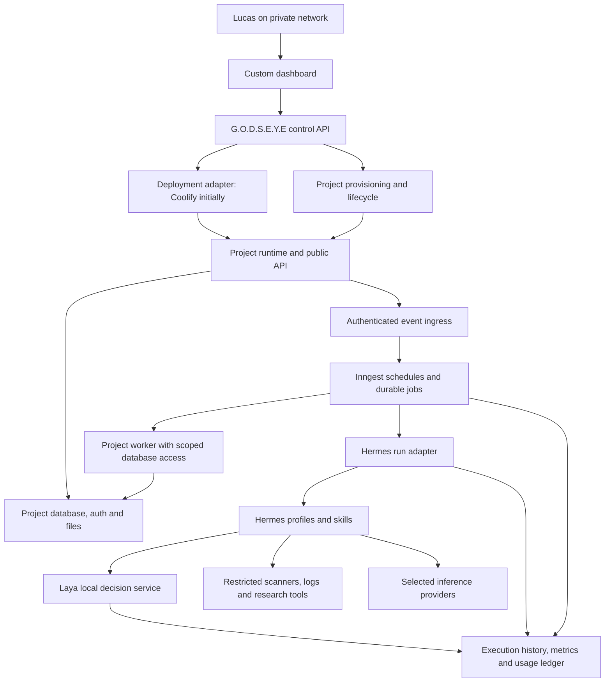

> Historical proposal. Superseded by the [current architecture](../architecture.md) and V1 specification.

---
node_type: research
topic: godseye-control-platform
date: 2026-11-11
mode: web
freshness_expires: 2026-12-11
confidence: medium
coverage: "partial: architecture and official documentation; implementation, release qualification and load tests pending"
supersedes: 2026-11-11-snapshot.md
---

# G.O.D.S.E.Y.E platform architecture

## Verdict

Build a private, owner-operated application platform with a custom dashboard, project backend services and TypeScript SDK.
Use Inngest for durable scheduling, Hermes as the core skills/agent runtime, and self-hosted Laya for selective low-cost decisions.
Use Coolify behind a replaceable deployment adapter; keep project definitions, data and operational contracts under G.O.D.S.E.Y.E ownership.

This is an architectural proposal, not deployed functionality. All third-party capability claims were checked against official documentation on 2026-11-11. Proposed interfaces, limits and delivery gates describe work to implement and validate.

## Delta from the initial proposal

The user's clarification supersedes the earlier interpretation: **n8n was a voice-transcription error and is removed entirely**. Hermes is a core execution engine, not an optional extra. The target backend covers application hosting, authentication, data, files, jobs and developer tooling; it is not merely PostgreSQL provisioning. The user explicitly accepts a custom SDK and case-by-case migrations from Supabase Cloud. Supabase protocol/API compatibility is therefore not a requirement.

The supplied decision-model link identifies **Laya**, despite the later voice transcription saying Llama. Laya and usage metering serve different purposes: local classification versus accounting. LiteLLM is no longer a required platform component. The Proxmox separation, single-host limits and off-host recovery principles from the earlier research remain applicable. [1][2]

## System boundaries

The owner console, administrative API, database provisioning, Hermes API and deployment credentials remain private. Public project APIs and end-user authentication are separate surfaces. A user's account in an application never grants access to the platform console. The deployment controller remains outside public project runtimes.

Retain separate games, production, control and execution VMs. Run costly tools, browsers and builds in execution; keep persistent Hermes profile state backed up. Start with one heavy concurrent execution and tune based on measurements. The earlier 16/24/8/8 GiB VM budgets plus 8 GiB host/headroom remain an initial hypothesis, not proof that every proposed module fits. Laya, log retention, file storage and agent work must be added to the capacity test. This still has one physical failure domain. [1]

## Platform stack

| Layer | Proposed choice | Scope |
| --- | --- | --- |
| Owner console | TanStack Start, React, TypeScript | Private administration, routes and application shell |
| UI | Tailwind CSS, shadcn/ui | Owned component code, themes and accessible interactions |
| Queries and operational tables | TanStack Query and Table | Cache invalidation, status views, filtering and history |
| Platform and project API template | Hono, Zod, typed HTTP contracts | A separate API service; no dependency on a hosted function platform |
| Persistence | PostgreSQL and Drizzle | Platform metadata and per-project databases/migrations |
| Authentication | Better Auth | Separate owner authentication and application-user instances |
| Durable execution | Self-hosted Inngest | Cron, event-driven work, retry, waiting and supervision |
| Agent runtime | Hermes | Skills, context, tools, sessions and task execution |
| Local decisions | Laya service | Typed classification, scoring and routing |
| File service | Custom authorization API, replaceable storage provider | Private local filesystem initially; optional qualified Garage/S3 adapter |
| Deployments | Coolify through an adapter | Initial infrastructure engine; no Coolify identifiers in public contracts |
| Quality | Biome, Husky, TypeScript, Vitest, Playwright | Fast local checks and authoritative CI verification |
| Workspace/runtime | pnpm workspaces, supported Node.js LTS | TypeScript services; Hermes/Laya retain their Python runtimes |

Current official docs cover TanStack Start, its shadcn integration, Tailwind/Vite, Hono, Better Auth, Drizzle migrations, Biome and Husky. Pin mutually compatible package/runtime versions when implementing; this proposal does not claim a tested version matrix. Husky hooks are convenience checks; CI repeats lint, typecheck and relevant tests because local hooks can be skipped. [3][4][5][6][7][8][9][10][11]

Use one repository with console, control API, project runtime template, workers, agent adapter, SDK and shared contracts. Share reusable code rather than deploying a service per dashboard tab. Support other backend languages through container images later; the first supported template is TypeScript.

## Our application backend

The platform owns project lifecycle and a coherent developer experience. Mature components implement the database and identity primitives; the custom code owns their composition, policy, APIs and SDK.

| Capability | Target behavior |
| --- | --- |
| Project lifecycle | Create, suspend, inspect, export and remove a project through audited operations |
| Environments | Independent development, preview and production configuration/data |
| Database | A database per project/environment, migrations, connection credentials and restore |
| Application runtime | Deploy the project's API/backend as an independent container/process |
| End-user identity | Project-specific users, sessions, OAuth configuration and identity keys |
| Files | Upload/download APIs, authorization, quotas, metadata and expiring access |
| Background work | Project event handlers and cron functions backed by Inngest |
| Realtime | Authorized application events and execution updates through SSE/WebSocket |
| Developer tools | Typed SDK, local development templates, API contracts and logs |
| Operations | Metrics, usage, budgets, backups, recovery evidence and lifecycle history |

### Provisioning and data isolation

Creating a project allocates platform-owned IDs; database(s) and roles; an API/runtime template; authentication configuration; file namespace; worker registration; observability labels; and deployment configuration. The initial operation creates development and production, with previews provisioned on demand. Keep a provisioning journal so retries resume or compensate instead of duplicating resources. Provisioning credentials belong only to the control service.

Separate databases are the required default, not merely project schemas. A shared PostgreSQL cluster is acceptable initially, but roles, database access and connection pools must be constrained. Use distinct migration-owner and runtime roles; remove inherited/public privileges that defeat isolation. Shared cluster storage and administrator access remain shared failure/trust boundaries. Offer a dedicated cluster/container when a project's requirements justify it. [12][13]

Keep platform metadata and Inngest's operational database separate from project data. Inngest does not automatically create or administer each application's database. Provisioners create databases; project workers use scoped connections when executing functions. Pool sizes must fit the total PostgreSQL connection budget across all projects.

### Authentication and API

The owner console uses one allowlisted identity, disabled public registration, passkeys and a recovery path. Application-user identity is configured per project/runtime with its own database, signing keys, origins and cookies. Better Auth documents database adapters and passkeys; JWT/JWKS endpoints are available when a separate service needs tokens, but the JWT plugin is not itself a session replacement. [7]

Hono application templates expose explicitly defined APIs using Drizzle and validated contracts. The browser never receives direct database credentials or an administrative service identity. The proposed `@godseye/client` is an internal SDK to build, not an existing package. It addresses project authentication, files, events and API calls; an administrative SDK is separate and server-only.

Do not promise arbitrary browser-to-table queries in the initial SDK. If a project needs automatic REST access, evaluate a per-database PostgREST provider with explicit exposed schemas, token verification and database policies. PostgREST delegates authorization to PostgreSQL roles; RLS requires deliberate configuration, and database owners/superusers commonly bypass policies. Better Auth is not automatically a Supabase-compatible JWT issuer. [13][14]

### Files and realtime

Start with a private filesystem provider behind a storage adapter, separate project/environment namespaces and a file metadata table. The API performs authorization and applies quotas; clients get short-lived file grants, not storage administrator credentials. Keep file deletion, restore and antivirus/content handling policies explicit. Use streaming/proxy access or a qualified signed-URL implementation rather than exposing private directories.

Garage is a self-hosted S3-compatible candidate for the next provider. Its compatibility is partial, and its own single-node quick start explicitly warns against production use without redundancy. Do not label three processes on the AX41 as independent failure domains. Adoption requires API compatibility, permissions, backup and failure tests, or an additional physical storage node; the filesystem provider remains valid for the explicitly single-host initial design. [15]

Initial realtime means application-domain events and job status, not a generic replacement for every Supabase database subscription. Durable events go into an outbox in the same database transaction as the business write; a dispatcher forwards them and records delivery. Clients reconnect with an event cursor or refetch current state. PostgreSQL NOTIFY can wake a dispatcher, but does not replace the durable outbox. Row-level change feeds, presence and broadcast authorization are later capabilities with separate acceptance criteria. [16]

### Independence from Supabase Cloud

Runtime data, identity/session state, file storage and cron ownership must operate without contacting Supabase Cloud. Existing projects migrate individually: database schema/data, identity/password/OAuth behavior, storage objects and grants, function logic, subscriptions and secrets. PostgreSQL compatibility alone does not migrate those other services. The accepted custom SDK avoids promising unchanged `supabase-js` behavior.

Email delivery, third-party OAuth and externally hosted model inference remain separate integrations. Owning the backend does not imply owning every external delivery or identity provider.

## Inngest as the scheduling authority

One self-hosted installation can coordinate the owner's projects; each project has its own worker code and database permissions. Use project/environment-scoped event names, function identities, bounded concurrency and per-project quotas. Public applications send events through an authenticated platform ingress that derives project identity from credentials, validates the event type and overwrites untrusted ownership fields. Event name prefixes and a caller-supplied project ID are not authorization. [17]

Keep SDK registration, signing material and event intake private. The reviewed self-host guide uses installation keys; do not assume cloud-style per-project credential/environment isolation. Treat the shared orchestrator as a trusted internal boundary. Separate production from experimental execution or deploy another instance when isolation requires it. [18]

Inngest handles cron, retries, waits and workflow progress; project code runs in project workers. For Hermes work, the function creates an operation, calls the agent adapter once, stores the Hermes run ID, waits/polls for completion and collects evidence. A successful HTTP submission is not a completed audit.

Hermes already has its own cron system, so leave Hermes cron definitions empty for centrally managed tasks and restrict cron-management tools. Do not schedule the same task in both systems or invent a global cron-disable setting. [19]

Current single-node `inngest start` is documented as beta. Qualify a pinned self-host release with deliberate persistence, external PostgreSQL/Redis where appropriate, retention, restart/recovery and idempotency tests. The self-host requirement is retained; failed qualification blocks critical orchestration rather than silently moving it to cloud. [18]

## Hermes as the operational agent engine

Hermes owns the agent loop: discover/load skills, reason over assigned context, invoke allowed tools, retain scoped memory and produce artifacts. G.O.D.S.E.Y.E owns permissions, schedules, project identity, budgets, task state and operator controls. Skills are Agent Skills-compatible documents with supporting scripts/references; existing Agentics skills need an execution/tool/path compatibility audit before server use. [20]

### Planned agent roles

| Role | Inputs and skills | Expected outputs |
| --- | --- | --- |
| Security | Owned target inventory, scanner evidence, dependency changes | Recurring assessments, new findings, reproduction evidence and remediation proposals |
| Operations | Filtered log queries, metrics, deployment changes and prior incidents | Deduplicated incidents, diagnosis and bounded remediation suggestions |
| Market research | Declared competitors, sources, prior snapshots and research skills | Source-linked changes, comparisons and useful signals |
| Marketing | Brand/context, approved sources, campaign objectives | Drafts, creative briefs and performance analysis |
| Coding | Assigned repository/worktree, tests and an issue | Patch/PR, validation evidence and preview |

These are proposed profiles/skill bundles, not claims that Hermes installs a complete security or marketing department. Scanners supply evidence; the agent triages and explains. Recurrent checks compare with earlier findings instead of producing the same report every day. Active scans stay within configured owned targets; privileged production changes and external publication use explicit platform policies. No scan establishes that an application has no vulnerabilities.

### Integration and run recovery

Use the native HTTP Runs API through a server-side adapter. It exposes capabilities, status, SSE events, stop and approval/clarification handling. Inspect capabilities on the pinned release. The API is disabled by default, loopback-bound by default and requires bearer authentication; expose it only to the private adapter. [21]

Persist the platform operation ID and returned Hermes run ID before monitoring progress. The documented API idempotency retention is 24 hours, not permanent. Claimed work interrupted by authority restart can become `unknown` and require resolution. Reconcile before retrying; prevent a retry from republishing, rescanning destructively or applying a patch twice. Neither Hermes nor Inngest grants global exactly-once external effects. [21]

Run one owner process per Hermes home/profile. Profiles separate configuration, sessions, memory and skills; they do not enforce OS isolation. A small number of role profiles can serialize work initially; add separate project-role homes for sensitive contexts or concurrency. Do not spawn parallel writers into one shared home. [22]

For deterministic skills, use profile `skills.auto_load` for API sessions or documented CLI `-s` loading through an adapter fallback. A CLI fallback needs an exclusive profile lease or a separate home, so it never runs beside another writer to the same home. Do not assume a slash command pasted into an API message activates a skill. The dashboard records the resolved skill version/content identity with the run. New or learned skills are staged, inspected and promoted into a versioned trusted catalog; enable skill-write approval where required rather than accepting unrestricted production mutations. [20][22][23][24]

### Execution permissions and operator experience

Hermes gets project-scoped tools: query redacted logs/metrics, read assigned files, invoke approved scanners and request platform actions. General shell work runs in constrained execution containers/VMs without production Docker or root SSH access. Profile separation is not a sandbox. The Docker backend can reuse a persistent profile/workspace sandbox; choose lifecycle deliberately and do not assume conversation isolation. [22][24][25]

The dashboard needs a real Agent Center: chat/task submission, project/profile selection, skill catalog, schedules, run timeline, live tools/log events, proposed changes, approval prompts, cancellation, artifact download, memory/context views and cost. Operators can see degraded or unknown runs and resolve them. A task must continue on the server when the PC disconnects.

## Laya and economical checks

Use Laya from the supplied upstream project as a self-hosted decision service. It returns typed choices/scores rather than writing audit explanations; upstream supports CPU execution and an HTTP-serving option. Do not confuse it with Llama model families. CPU latency, memory, throughput and decision quality on the AX41 remain unmeasured. [2]

Proposed cascade: deterministic rules and deduplication first; Laya for bounded classification or prioritization; Hermes with a selected generative model when interpretation/action is warranted. Use a representative held-out French/English dataset to choose thresholds. Randomly audit a sample of low-priority results and preserve deterministic escalation for critical scanner evidence, so a classifier cannot silently suppress serious incidents.

Candidate decisions: repeated versus new log pattern, security versus infrastructure versus application issue, relevance of a competitor update, and whether a content item merits deeper review. Laya is not the vulnerability scanner, permission system or replacement for all generative inference. Local decisions have CPU/RAM costs even without a per-call external token charge.

Usage accounting is a separate module: collect project, operation, agent, skill, model, provider attempt, reported tokens, latency and estimated cost. Record missing usage as unknown. Track local decision counts/resources separately. An internal instrumented model client and supported Hermes events may be enough initially; keep a model-gateway adapter available if a proxy later proves useful. Qualify actual usage fields and fallback paths before claiming complete costs. LiteLLM is optional, not the decision engine.

## Replaceable deployment engine

Define a platform-owned deployment contract: create/update service, build/publish artifact, deploy immutable artifact, set domain, get status/logs, create/remove preview, list rollback candidates and restore an eligible image. Coolify implements the first provider using its supported API. Its documented previews, deployments and rollback mechanics support this direction, subject to pinned-release qualification. [26]

Own the project/environment identifiers, image registry references, domains, file/database references, manifests and lifecycle history. Store Coolify IDs only in provider mappings. Contract tests should run against a fake provider and the installed engine. A provider capability matrix exposes unsupported operations instead of silently changing behavior.

A future custom deployer must take over reconciliation, runtime lifecycle, TLS/proxy configuration, credentials injection, health checks, log collection, artifact retention and rollback. This is real implementation work, not a configuration switch. Container/data formats help portability, but do not make live migration automatic. Database restore remains distinct from image rollback.

## Delivery gates

1. **Private foundation:** validate actual AX41 hardware, networking, VM boundaries and off-host restore. Initialize the monorepo and quality checks; prove the console and control API reject any non-owner identity.
2. **First complete project:** create development/production databases and roles; deploy an API with its own auth and files; consume it through the custom SDK. Prove project A cannot read project B's data/files or authenticate with B's tokens. Demonstrate backup/restore and no Supabase Cloud runtime dependency.
3. **Durable project jobs:** register a worker, run cron and event jobs, test outbox delivery, duplicate events, crash/resume and scoped database access. Qualify Inngest's selected self-host release.
4. **Core Hermes integration:** version two initial skills, one log-investigation role and one security-evidence role; invoke through the Runs API and observe/cancel from the console. Prove skill preloading, scoped tools, unknown-run recovery and usage attribution. Add marketing/competitor profiles after these contracts work.
5. **Economical operation and provider portability:** evaluate Laya against held-out data; compare cost/resource/quality before routing traffic through it. Validate the deployment adapter, preview runtime isolation and data-safe rollback procedure; expand realtime/file providers and migrate existing projects by need.

The first functional demonstration should be a real project with its database, API, SDK call and scheduled Hermes report visible in the private console. No empty dashboard controls should be presented as completed operations.

## Sources

All accessed 2026-11-11. Pages from the same organization are one source group, not independent corroboration. Library choices are proposals; current documentation confirms capabilities, not the performance or compatibility of the final composition.

| ID | Source | Group |
| --- | --- | --- |
| 1 | [Initial hardware, isolation and recovery research](2026-11-11-architecture.md) and its primary sources; superseded for product requirements | Prior SCOUT dossier |
| 2 | [Laya upstream](https://github.com/NandhaKishorM/laya) | Laya |
| 3 | [TanStack Start](https://tanstack.com/start/latest/docs/framework/react/overview) | TanStack |
| 4 | [shadcn/ui TanStack installation](https://ui.shadcn.com/docs/installation/tanstack) | shadcn |
| 5 | [Tailwind and Vite](https://tailwindcss.com/docs/installation/using-vite) | Tailwind |
| 6 | [Hono documentation](https://hono.dev/docs/) | Hono |
| 7 | [Better Auth database](https://better-auth.com/docs/concepts/database), [passkeys](https://better-auth.com/docs/plugins/passkey), [JWT](https://better-auth.com/docs/plugins/jwt) | Better Auth |
| 8 | [Drizzle migrations](https://orm.drizzle.team/docs/migrations) | Drizzle |
| 9 | [Biome quick start](https://biomejs.dev/installation/quick-start/) | Biome |
| 10 | [Husky](https://typicode.github.io/husky/) | Husky |
| 11 | [Vitest](https://vitest.dev/guide/), [Playwright](https://playwright.dev/docs/intro) | Vitest; Playwright, distinct groups |
| 12 | [PostgreSQL database management](https://www.postgresql.org/docs/current/managing-databases.html), [privileges](https://www.postgresql.org/docs/current/ddl-priv.html) | PostgreSQL |
| 13 | [PostgreSQL RLS](https://www.postgresql.org/docs/current/ddl-rowsecurity.html) | PostgreSQL |
| 14 | [PostgREST configuration](https://docs.postgrest.org/en/stable/references/configuration.html), [authentication](https://docs.postgrest.org/en/latest/references/auth.html) | PostgREST |
| 15 | [Garage quick start and redundancy warning](https://garagehq.deuxfleurs.fr/documentation/quick-start/), [S3 compatibility](https://garagehq.deuxfleurs.fr/documentation/reference-manual/s3-compatibility/) | Garage |
| 16 | [PostgreSQL NOTIFY](https://www.postgresql.org/docs/current/sql-notify.html) | PostgreSQL |
| 17 | [Inngest event model](https://www.inngest.com/docs/durable-execution/guides-and-advanced/events-and-triggers) | Inngest |
| 18 | [Inngest self-host operation and beta status](https://www.inngest.com/docs/platform-and-operations/self-host-inngest) | Inngest |
| 19 | [Hermes cron and scheduler](https://hermes-agent.nousresearch.com/docs/user-guide/features/cron) | Hermes |
| 20 | [Hermes skills](https://hermes-agent.nousresearch.com/docs/user-guide/features/skills) | Hermes |
| 21 | [Hermes HTTP API and run recovery](https://hermes-agent.nousresearch.com/docs/user-guide/features/api-server) | Hermes |
| 22 | [Hermes profiles](https://hermes-agent.nousresearch.com/docs/user-guide/profiles) | Hermes |
| 23 | [Hermes CLI and explicit skills](https://hermes-agent.nousresearch.com/docs/user-guide/cli) | Hermes |
| 24 | [Hermes configuration and sandbox lifecycle](https://hermes-agent.nousresearch.com/docs/user-guide/configuration) | Hermes |
| 25 | [Hermes security and tool boundaries](https://hermes-agent.nousresearch.com/docs/user-guide/security) | Hermes |
| 26 | [Coolify API](https://coolify.io/docs/api/endpoints/deployments/deploy-by-tag-or-uuid), [previews](https://coolify.io/docs/applications/deployments/preview-deployments), [rollbacks](https://coolify.io/docs/applications/deployments/rollbacks) | Coolify |

## Method and remaining qualification

Refresh of the same research topic after an explicit user correction, with one narrow Hermes documentation researcher and centralized synthesis. Three search queries were used for Garage, PostgREST and Better Auth; the rest used direct official-page inspection and the previous sourced dossier. No third-party commentary was used to establish technical capabilities. Freshness is intentionally limited to 30 days because these integration surfaces evolve quickly.

The user accepted a custom SDK and migrations adapted per application. This supersedes only the earlier product interpretation: it does not contradict historical vendor facts. The previous immutable vault snapshot is retained as history and this revision supersedes it.

Counterarguments addressed: a custom backend requires auth/files/realtime semantics beyond PostgreSQL; profiles are not security boundaries; shared orchestration keys are not project isolation; Hermes has a competing scheduler; agent retries are not globally exactly-once; local classification is not free computation; single-node storage is not redundant; a deployment adapter does not implement its replacement.

Coverage is partial: actual hardware, model evaluation, current release pins, API capability probes, per-run usage completeness, migration compatibility, storage durability, restore drills and load/cost measurements remain implementation gates. Docker/process isolation and application RLS need executable tests. There is no guaranteed delivery timeline, no measured AX41 inference budget and no deployed software in this revision.

Fresh-context FABER review: passed all eight research criteria with no findings. The critic independently checked the decisive Hermes, Inngest, Laya, Garage and deployment claims, rather than every cited page. Runtime containment, recovery, release compatibility and capacity remain unverified implementation gates. The shell schema validator was unavailable because jq was absent; required verdict fields were checked with Python at delivery.
